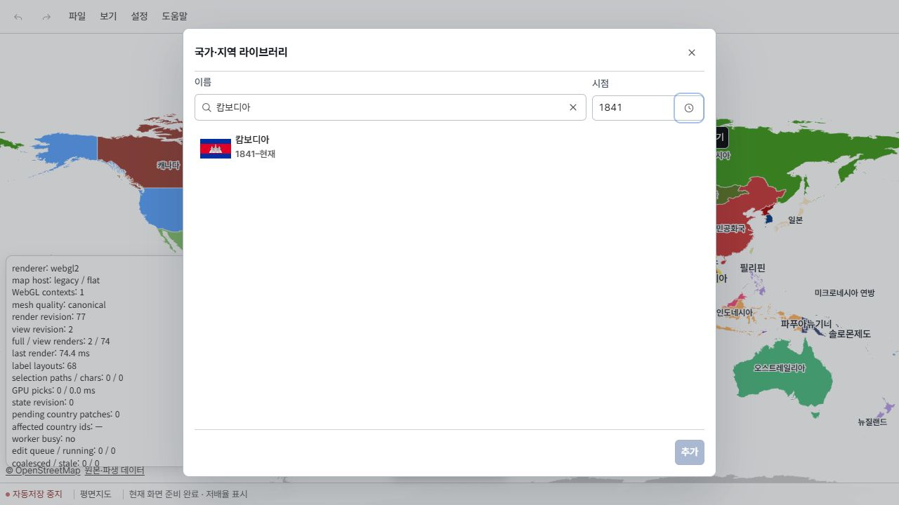
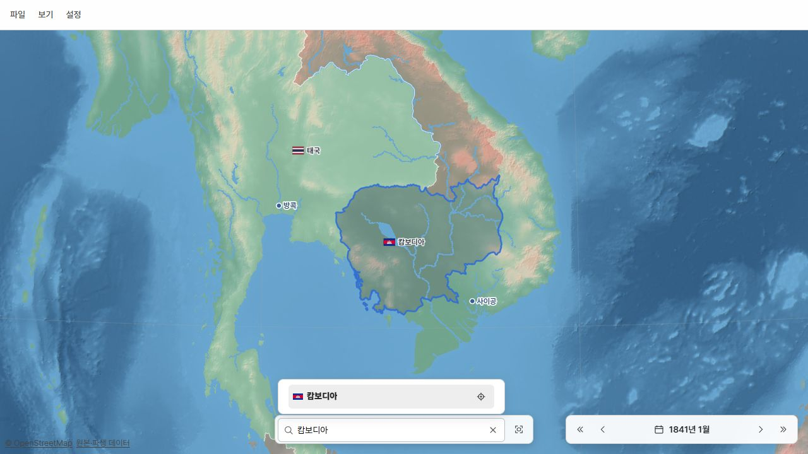

# 현존 정치체의 존속기간 보충

> ID: GEO-LIFE-EXTANT-20261025 · 조사일: 2026-10-25 · 상태: 확정 66개 정본·파생 반영 / work/gis 푸시·집중 검증 완료

현행 목록 258개 중 시작일이 비어 있던 152개를 조사했다. 사용자 선택과 확인된 근거에 따라 66개를 반영했다. 35개는 정치체 범위·대표 사건 선택 대기, 51개는 근거 부족·연속성 불명확·비정치체로 보류한다. 불명확한 대상에 임의의 날짜를 입력하지 않았다.

기존 work/gis와 고정 자료 경로를 재사용한다. 최초 자료 기준 127e51c3457df87786ecf3aa5ad98ded690928df, 병합한 공개 자료 핀 1879138b54b2c9f8c173bf5575b108e3f1f8139b. 앞선 65개 원문 수정과 공개 소련·우크라이나 11개 경로를 대조해 보존하고 캄보디아 1841년을 추가했다.

## 적용 기준

- 현존 객체에는 사용자가 선택한 최신 연속 구간을 적용하며, 이전 구간을 임의로 하나로 합치지 않는다.
- 식민 행정구역은 별도 전신으로 본다. 속국화·국호·헌법·정권 변경만으로 국가 존속을 자동 종료하거나 다시 시작하지 않는다.
- 확인한 날짜 정밀도를 유지한다. 입증된 구력은 그레고리력으로 환산하고 원래 날짜와 달력을 보존한다.
- 영국은 Julian 1707-05-01을 Gregorian 1707-05-12로 환산했다. 폴란드는 섭정 통치 개시 1917-10-27, 사우디는 제다 공식 항복 1925-12-21을 사용자 기준으로 선택했다.
- 캄보디아는 영토 정부 재건의 대표 연도인 1841년을 사용자가 선택했다. 정확한 개시 월일은 미상이다. 도착일·이전일·대관식 날짜를 대신 넣지 않는다.
- 수정 대상은 lifetime과 해당 출처 기록뿐이다. 종료일은 열린 상태로 유지한다. 좌표·형상 기간·부모 관계·계보·기존 승인 날짜는 보존했다.

## 지역별 진행

| 지역 | 조사 | 반영 | 선택 대기 | 보류 |
| --- | ---: | ---: | ---: | ---: |
| 유럽 | 35 | 28 | 0 | 7 |
| 아시아 | 37 | 16 | 9 | 12 |
| 북·중미·카리브해 | 29 | 8 | 8 | 13 |
| 남미 | 10 | 2 | 4 | 4 |
| 아프리카 | 17 | 5 | 5 | 7 |
| 오세아니아 | 22 | 7 | 8 | 7 |
| 미분류 | 2 | 0 | 1 | 1 |

## 실제 입력 날짜와 출처

| ID | 정치체 | 입력 | 기준 | 출처 |
| --- | --- | --- | --- | --- |
| state:ALD | 올란드제도 | 1920-05-07 | 법적 자치 정체의 시작은 명시된 최초 자치법 시행일을 채택할 수 있다. 법 서명일 1920-05-06과 시행일 1920-05-07을 구분한다. 최초 법에 대한 현지의 불수용 때문에 기관 운영은 지연되었으며, 1921 국제합의와 1922 첫 개회는 별도 사건으로 보존한다. 그 이전의 지리적 지역 또는 보통 행정구역을 같은 자치 정체로 소급한 판정은 아니다. | [Lag om självstyrelse för Åland, 124/1920](https://www.lagtinget.ax/sites/www.lagtinget.ax/files/alands_sjalvstyrelselag_124-1920.pdf) [Ålands Lagting – Parliament of Åland](https://www.lagtinget.ax/english/alands-lagting-parliament-aland) [Lag angående bringande i verkställighet av lagen om självstyrelse för Åland](https://www.lagtinget.ax/sites/www.lagtinget.ax/files/125-1920.pdf) |
| state:AND | 안도라 | 1278-09-15 | Government explicitly identifies 1278 as the Principality's birth; the French co-prince supplies the day. The earlier episcopal lordship is recorded in 1133. Later pareage, French co-lord relations and the 1993 constitution do not automatically restart the polity. | [Andorra Government: Historia d'Andorra](https://www.govern.ad/ca/tematiques/cultura-i-esports/patrimoni-cultural/coneixer-el-patrimoni-cultural/historia-d-andorra) [French co-prince: Histoire de la Principaute](https://www.coprince-fr.ad/fr/histoire-de-la-principaute) [First Pareage1278, Catalan original-document translation from Government1988edition](https://ca.wikisource.org/wiki/Sent%C3%A8ncia_Arbitral_de_l%27any_1278_%28Primer_Pariatge_d%27Andorra%29) |
| state:AUT | 오스트리아 | 1945-04-27 | Latest restored republic only, as explicitly selected; earlier Austrian periods remain separate. | [Austrian Parliament: Die Geburt der Republik](https://www.parlament.gv.at/verstehen/historisches/1918-1945/geburt-der-republik) |
| state:BGR | 불가리아 | 1878-03-03 | User selected San Stefano national restoration rather than later treaty revision or full independence. | [Bulgaria Council of Ministers: History](https://government.bg/en/About-Bulgaria/HISTORY/tabsss1) |
| state:BIH | 보스니아헤르체고비나 | 1992-03-06 | User selected current independent state, excluding Yugoslav constituent period; UN succession records international responsibility from this date. | [BIH Consulate: Statehood Day](https://www.bihconsulatesydney.com/we-are-celebrating-our-statehood-day-25-november/) |
| state:CHE | 스위스 | 1291-08 | User accepted the Federal Charter as conventional origin, not an attested first-ever alliance or invented August 1 signing day. | [Swiss Federal Council: Bundesbrief von 1291](https://www.admin.ch/de/bundesbrief-von-1291) |
| state:DEU | 독일 | 1867-07-01 | User explicitly included the North German federal state; 1871 expansion, 1919 regime and 1949 reorganisation do not restart this selected continuity. | [Bundestag: Völkerrechtssubjekt Deutsches Reich](https://www.bundestag.de/webarchiv/presse/hib/2015_06/380964-380964) |
| state:ESP | 에스파냐 | 1716-01-16 | User chose Bourbon institutional integration rather than the 1479 personal union. This is the final Nueva Planta decree, not a single new-kingdom founding proclamation. | [Spanish Education Ministry INTEF: La Union Dinastica](https://descargas.intef.es/recursos_educativos/It_didac/Geo_Hist_ESO/2/07/03_La_Union_Dinastica/la_unin_dinstica_y_la_poltica_interior_de_los_rrcc.html) |
| state:FRA | 프랑스 | 0843 | User accepted West Francia after the Verdun partition as the conventional origin of the current polity; dynasty and republic changes do not restart it. | [Herve Lemoine: La Maison de l'histoire de France, April 2008](https://www.vie-publique.fr/files/rapport/pdf/094000029.pdf) [French National Assembly: Revolution francaise](https://www.assemblee-nationale.fr/dyn/histoire-et-patrimoine/revolution-francaise) |
| state:GBR | 영국 | 1707-05-12 | Lords opinion calls 1707 a new state; parliamentary regnal data separates Great Britain and United Kingdom. Government-commissioned Crawford/Boyle opinion discusses both new-state and enlarged-continuing-England interpretations. Follow the pending user choice among 1707, 1801 and blank; name change alone cannot decide. | [House of Lords: Committee for Privileges Second Report](https://publications.parliament.uk/pa/ld199899/ldselect/ldprivi/108i/10806.htm) [UK Parliament: Kingdoms](https://api.parliament.uk/regnal-years/kingdoms) [Crawford and Boyle: Scotland international-law opinion, Annex A](https://assets.publishing.service.gov.uk/media/5a79e4fbed915d042206bcf5/Annex_A.pdf) |
| state:GGY | 건지섬 | 1204 | 건지 정부의 헌정 설명과 Jersey Legal Information Board의 설명이 모두 1204년을 현재 자치·사법독립 관계의 출발로 제시한다. 1066년은 노르망디 공작의 잉글랜드 왕위 취득이므로 건지의 신설일로 사용하지 않는다. 근거는 연도 정밀도이며 일·월을 만들어 붙이지 않는다. | [Written evidence submitted by the government of Guernsey (TTC 41)](https://committees.parliament.uk/writtenevidence/125181/html/) [About the Jersey and Guernsey Law Review](https://www.jerseylaw.je/publications/jglr/Pages/About.aspx) |
| state:GIB | 지브롤터 | 1713-07-13 | User selected legal cession under Utrecht Article X rather than the 1704 occupation; treaty dual date gives Gregorian July 13. | [Gibraltar National Museum — A Brief History of Gibraltar](https://www.gibmuseum.gi/our-history/brief-history-of-gibraltar) [UK Parliament — Treaty of Peace and Friendship, Utrecht, Article X](https://publications.parliament.uk/pa/cm199899/cmselect/cmfaff/366/36615.htm) [320 years of the capture of Gibraltar — 544/2024](https://www.gibraltar.gov.gi/press-releases/320-years-of-the-capture-of-gibraltar-5442024-10123) |
| state:GRC | 그리스 | 1822-01-13 | User selected the 1822 national constitution/declaration rather than 1830 recognition. Original Greek Julian January 1 is Gregorian January 13. | [Greek MFA: International Treaties and Protocols](https://200years.mfa.gr/en/international-treaties-en/) |
| state:HRV | 크로아티아 | 1991-10-08 | User selected independent Croatia, excluding constituent predecessors; Parliament distinguishes June 25 declaration from implementation and final severance after the Brioni moratorium. | [Croatian Parliament: 25 June Independence Day](https://www.sabor.hr/en/about-parliament/history/important-dates/25-june-independence-day) |
| state:ISL | 아이슬란드 | 1918-12-01 | User selected modern sovereign-state restoration and left the 930 commonwealth as an earlier predecessor; 1944 republic is not a new start. | [Althingi — Official English booklet, 2018](https://www.althingi.is/pdf/Althingi2018_enska.pdf) [Government of Iceland — Leiðin til sjálfstæðis](https://www.stjornarradid.is/rikisstjorn/sogulegt-efni/heimastjorn-1904-1918/leidin-til-sjalfstaedis/) |
| state:JEY | 저지섬 | 1204 | 저지 정부는 1204년에 부여된 자체 법에 따른 통치와 왕실 관계를 오늘날 헌정의 기초로 제시한다. 별도 자치 행정·법체계에 대한 공식 법률정보기관 설명과 일치한다. 1856·1948 의회 구성 변경은 정체 재성립으로 취급하지 않는다. 일·월은 근거가 없으므로 연도만 보존한다. | [Government of Jersey — Jersey's history](https://www.gov.je/Leisure/Jersey/pages/history.aspx) [About the Jersey and Guernsey Law Review](https://www.jerseylaw.je/publications/jglr/Pages/About.aspx) |
| state:KOS | 코소보 | 2008-02-17 | 이날 독립·주권국가를 선언한 분쟁 정치체. 보편적 승인일을 뜻하지 않음. | [Kosovo Declaration of Independence](https://kryeministri.rks-gov.net/en/news/kosovo-declaration-of-independence/) [Serbian Government decision](https://www.srbija.gov.rs/vest/en/43154/government-decides-to-annul-illegal-acts-pertaining-to-declaration-of-kosovo-metohijas-unilateral-independence.php) |
| state:LIE | 리히텐슈타인 | 1719-01-23 | Government explicitly distinguishes creation of the Principality in 1719 from sovereignty in 1806. The merger creating this polity is supported to the day; 1806-07-12 changes the status of an already-existing principality. | [Government of Liechtenstein: Encounter with a Small State](https://www.regierung.li/files/attachments/20251125-broschuere-begegnung-mit-einem-kleinstaat-639080401433496309.pdf) [Official 300 Years of Liechtenstein: Meilensteine](https://www.300.li/wissenwertes/meilensteine-liechtensteins-geschichte) [Liechtenstein State Archives: Imperial decree on Vaduz and Schellenberg](https://www.e-archiv.li/textDetail.aspx?backurl=auto&eID=4&etID=46360) |
| state:LUX | 룩셈부르크 | 1815-06-09 | User selected the latest restoration under the Vienna Final Act, excluding the interrupted medieval duchy and French annexation interval. | [Ministry of the Interior — La législation communale, July 2018](https://mint.gouvernement.lu/dam-assets/personnel-communal/recrutement-examen-d-admissibilite/programmes/Organisation-des-communes-admissibilite-B1-A-A2-A1.pdf) [Luxembourg Government — La Renaissance d'un pays](https://luxembourg.public.lu/fr/societe-et-culture/histoire/renaissance-dun-pays.html) [Luxembourg Government — 400 ans de souverains étrangers](https://luxembourg.public.lu/fr/societe-et-culture/histoire/400-ans-souverains-etrangers.html) |
| state:MCO | 모나코 | 1814-05-30 | User selected the latest restored principality; the Paris treaty restores pre-1792 relations. Earlier Grimaldi periods are not flattened through annexation. | [Palais Princier de Monaco — Le Palais des Princes de Monaco](https://palais.mc/fr/l-institution/le-palais-des-princes-de-monaco-1-16.html) [IMSEE — Monaco en Chiffres 2024, Territoire et Environnement](https://www.imsee.mc/content/download/525246/6019179/file/Monaco%20en%20Chiffres%202024%20-%201.%20Territoire%20et%20Environnement.pdf) [Monaco Government — Annexion à la France](https://www.gouv.mc/Gouvernement-et-Institutions/Histoire-et-Patrimoine/Epoques/Le-temps-des-difficultes-1793-1861/Annexion-a-la-France) |
| state:MKD | 북마케도니아 | 1991-09-17 | 1944부터 정치체 연속성 포함 여부 사용자 질문 중. 1991-09-08은 국민투표, 11-17은 헌법. | [Assembly of North Macedonia: Declarations](https://www.sobranie.mk/deklaracii.nspx) |
| state:MNE | 몬테네그로 | 2006-06-03 | 옛 독립국 1878~1918 및 연방 정치체와 현재 구간 선택. 사용자 질문 중. | [Museum of AVNOJ: Crna Gora 2](https://www.muzejavnoj.ba/virtualna_tura/crna-gora-2/) |
| state:NLD | 네덜란드 | 1813-11-21 | User selected the latest restored state. The dated General Government proclamation and national archival entry establish November 21; distinguish assumption/proclamation from summaries of November 20. | [Nationaal Archief — Plakkaat van Verlatinge (1581)](https://nationaalarchief.nl/beleven/onderwijs/bronnenbox/plakkaat-van-verlatinge-1581) [Nationaal Archief — Wetgevende Colleges, inventory 2.01.01.01](https://www.nationaalarchief.nl/onderzoeken/archief/2.01.01.01/download/pdf) [Royal House of the Netherlands — Kingdom of the Netherlands](https://www.royal-house.nl/topics/history/history-of-the-kingdom-of-the-netherlands) |
| state:POL | 폴란드 | 1917-10-27 | User explicitly selected actual Regency Council rule, not the 1916 founding promise, September 1917 installation patent, or 1918 independent republic. | [Polish Education Ministry: The Year 1918](https://zpe.gov.pl/a/a-strange-end-to-the-war-the-year-1918/D17qr0alf) |
| state:PRT | 포르투갈 | 1143 | User selected Zamora recognition as the origin. Use the government confirmed founding year without treating the traditional royal acclamation or recognition as an independently established exact creation day. | [Government of Portugal: Sobre Portugal](https://portugal.gov.pt/pt/gc24/portugal/sobre-portugal) [Government of Portugal: Commission for 900 years of foundation](https://portugal.gov.pt/gc25/comunicacao/noticias/governo-cria-comissao-para-celebrar-900-anos-da-fundacao-de-portugal) [Municipality of Guimaraes: D. Afonso Henriques](https://www.visitguimaraes.travel/descobrir-guimaraes/personalidades-ilustres/d-afonso-henriques) |
| state:ROU | 루마니아 | 1859-02-05 | Modern state formation at the double election, not the later 1862 name/administrative consolidation. Apply the user selected Gregorian conversion to Julian January 24. | [Romanian Ministry of Defence: Repere istorice](https://www.mapn.ro/repere_istorice/) |
| state:SRB | 세르비아 | 2006-06-05 | User selected the current independent Serbian state interval. Use the National Assembly decision formally assuming successor-state powers; Montenegro declaration and dissolution background is June 3. | [Serbian National Assembly: Posle Drugog svetskog rata](https://www.parlament.gov.rs/narodna-skup%C5%A1tina/istorijat/posle-drugog-svetskog-rata.938.html) |
| state:TUR | 튀르키예 | 1920-04-23 | User explicitly selected Ankara national assembly/government and treats Ottoman state as predecessor rather than including its medieval origin. | [Grand National Assembly of Turkiye: History](https://www.tbmm.gov.tr/history/) [Culture and Tourism Ministry: Biography of Ataturk](https://www.ktb.gov.tr/EN-103908/biography-of-ataturk.html) [UN RIAA: Ottoman Public Debt Award, 18 April 1925](https://legal.un.org/riaa/cases/vol_I/529-614.pdf) [Bilecik Governorate: Osman Gazi](https://bilecik.gov.tr/osman-gazi) |
| state:AFG | 아프가니스탄 | 1747 | Modern state foundation explicitly supported; year precision. Later regime/status changes do not restart it. | [Afghanistan Embassy Abu Dhabi](https://abudhabi.mfa.gov.af/en/afghanistan/) |
| state:BHR | 바레인 | 1783 | Current political formation1783 continues through protection and independence; source supports year only, not2002 kingdom reset. | [British Library-Qatar Digital Library Bahrain historical profile](https://qdl.qa/en/historical-profile-bahrain) [Bahrain Justice Ministry Judicial History](https://www.moj.gov.bh/en/about-the-ministry/judicial-history) |
| state:CHN | 중화인민공화국 | 1949-10-01 | User explicitly selected PRC political identity, separately from ROC/Qing. | [PRC government historical chronology](https://www.locpg.gov.cn/zggq/2014-01/04/c_125956418.htm) |
| state:ESB | 데켈리아 | 1960-08-16 | Dhekelia as separate base territory begins under 1960 treaty; do not backdate to all British Cyprus. | [UN Treaty Collection No. 5476](https://treaties.un.org/Pages/showDetails.aspx?clang=_en&objid=08000002801388ac) [UNTS Volume 382](https://treaties.un.org/doc/Publication/UNTS/Volume%20382/v382.pdf) [UK MOD Integrated Global Defence Network](https://www.gov.uk/government/publications/permanent-joint-operating-bases-pjobs/fd) [Sovereign Base Areas Order 1960 SI 1369](https://www.legislation.gov.uk/uksi/1960/1369/pdfs/uksi_19601369_en.pdf) |
| state:IRN | 이란 | 1501 | User explicitly selected Safavid reunification in 1501 as the current polity origin; do not merge earlier interrupted Persian empires or restart for the 1979 regime. | [LOC Iran Profile2008](https://tile.loc.gov/storage-services/master/frd/copr/Iran.pdf) [US Historian Iran](https://history.state.gov/countries/iran) |
| state:IRQ | 이라크 | 1921 | Iraq government submission explicitly identifies state establishment in1921. No supported founding month/day; republic and mandate end do not restart polity. | [Iraq HRI/CORE/IRQ/2019](https://documents.un.org/doc/undoc/gen/g19/351/45/pdf/g1935145.pdf) [Iraq MFA National Holiday](https://mofa.gov.iq/delhi/?lang=en&p=1741) |
| state:JOR | 요르단 | 1921-04-11 | Official government separates emirate founding from independence; retain continuity through constitutional and status changes. | [Jordan Government Hashemite Monarchs](https://jordan.gov.jo/EN/Pages/Hashemite_Monarchs_of_Jordan) |
| state:KHM | 캄보디아 | 1841 | 사용자가 1841년을 선택했다. 앙두엉이 여러 지방에 관료와 군 지휘관을 배치하고, 늦어도 그해 말에는 북부의 영토 정부로 작동한 시기를 현존 객체의 대표 기원으로 삼는다. 정확한 개시 월일은 미상이며 우동 도착일·프놈펜 이전일·대관식 날짜로 대체하지 않는다. 802년부터의 무중단 연속성을 확정한 것은 아니다. | [Cambodia Embassy UK](https://www.cambodiaembassyuk.org/information-for-visitors/) [US Historian Cambodia](https://history.state.gov/countries/cambodia) [David P. Chandler, Cambodia Relations with Siam in the Early Bangkok Period, 1972](https://thesiamsociety.org/wp-content/uploads/1972/03/JSS_060_1d_Chandler_CambodiaRelationsWithSiamInEarlyBangkokPeriod.pdf) |
| state:LBN | 레바논 | 1920-09-01 | Greater Lebanon continues through republic and independence. Earlier Mount Lebanon regime was abolished during WWI, so do not flatten across that interruption. | [Lebanese Army State Development](https://www.lebarmy.gov.lb/ar/node/771) [Lebanon MFA Ministry History](https://www.mfa.gov.lb/SubPage.aspx?PageID=125) |
| state:PAK | 파키스탄 | 1947-08-15 | Direct original law specifies15th;14th transfer ceremony differs. Ask which event; do not lower precision to hide conflict.1956 republic not restart. | [Indian Independence Act1947 section1](https://www.legislation.gov.uk/ukpga/Geo6/10-11/30/pdfs/ukpga_19470030_en.pdf) [Pakistan National Assembly Brief Parliamentary History](https://na.gov.pk/en/content.php/content.php?id=75) |
| state:PSX | 팔레스타인 | 1988-11-15 | For included disputed states use directly read declaration; distinguish PA administrative institution and later UN status. | [A/43/827-S/20278 Declaration of Independence](https://documents.un.org/api/symbol/access?l=en&s=A%2F43%2F827&t=pdf) [UN General Assembly67/19](https://documents.un.org/api/symbol/access?l=en&s=A/RES/67/19&t=pdf) [ILO Occupied Territories report](https://www.un.org/unispal/document/auto-insert-197680/) |
| state:SAU | 사우디아라비아 | 1925-12-21 | User selected the polity after annexing Hail and Hejaz. Contemporary December 22 telegram 73 says Jeddah officially surrendered yesterday; December 22 in telegram 72 is Ali departure, not the surrender. | [Saudi MFA KSA History](https://www.mofa.gov.sa/en/ksa/Pages/history.aspx) |
| state:TWN | 중화민국 | 1912-01-01 | User explicitly selected ROC political identity; later relocation does not restart it. | [ROC Office of the President founding chronology](https://english.president.gov.tw/page/49) |
| state:VNM | 베트남 | 1945-09-02 | User explicitly selected Democratic Republic of Vietnam declaration as this current entity origin, treating earlier dynastic polities as predecessors. | [Vietnam MFA History](https://mofa.gov.vn/lich-su1) |
| state:WSB | 아크로티리 | 1960-08-16 | Akrotiri as separate base territory begins under 1960 treaty; do not backdate to all British Cyprus. | [UN Treaty Collection No. 5476](https://treaties.un.org/Pages/showDetails.aspx?clang=_en&objid=08000002801388ac) [UNTS Volume 382](https://treaties.un.org/doc/Publication/UNTS/Volume%20382/v382.pdf) [UK MOD Integrated Global Defence Network](https://www.gov.uk/government/publications/permanent-joint-operating-bases-pjobs/fd) [Sovereign Base Areas Order 1960 SI 1369](https://www.legislation.gov.uk/uksi/1960/1369/pdfs/uksi_19601369_en.pdf) |
| state:YEM | 예멘 | 1990-05-22 | Agreement and joint notice specify single state merger; distinguish earlier independent northern/southern states and2006registration. | [UN Treaty Collection42830 Yemen proclamation agreement](https://treaties.un.org/Pages/showDetails.aspx?objid=0800000280067a61) [UN Treaty Collection Historical Information](https://treaties.un.org/pages/historicalinfo.aspx) |
| state:BMU | 버뮤다 | 1612 | Official governor succession begins1612, distinct from1609 shipwreck; Company/Crown transition does not restart. | [Bermuda Government Previous Governors](https://www.gov.bm/previous-governors-bermuda) |
| state:CAN | 캐나다 | 1867-07-01 | Three distinct colonies form new Dominion;prior Canada divides intoOntario/Quebec. Later independence powers not restart. | [Canada Constitution Act1867](https://laws.justice.gc.ca/eng/const/page-1.html) [Canada Gazette1868 proclamation](https://www.canada.ca/en/canadian-heritage/campaigns/canada-day/about/dominion-day/newspaper-extracts.html) |
| state:CLP | 클리퍼턴섬 | 1858-11-17 | As a separately listed dependency rather than sovereign country, use verified continuing French territorial jurisdiction. Discovery1711, Mexican occupation and1931 adjudication are not new polity founding dates. Award specifically distinguishes lack of local administration from loss of territorial title. | [Clipperton Island arbitral award1931, RIAA II1105-1111](https://legal.un.org/riaa/cases/vol_II/1105-1111.pdf) |
| state:GRL | 그린란드 | 1721 | Official Denmark MFA identifies modern colonial origin1721;medievalNorse settlement not continuously merged. | [Danish Embassy Japan Greenland History](https://um.dk/japan/en/about-denmark/greenland/history-and-culture/) |
| state:MAF | 생마르탱 | 1648 | French distinct territory from1648; not reset by municipal/COM status. Official13/23March day spellings unresolved; year confirmed. | [Saint Martin Government territorial description](https://www.com-saint-martin.fr/thematiques/emploi_formation/emploi_et_apprentissage/offres_emploi/et-O971261014000002) [Saint Martin History](https://www.com-saint-martin.fr/thematiques/organisation-territoriale/votre-collectivite/histoire-de-la-collectivite) [Prefecture methodology note](https://www.saint-barth-saint-martin.gouv.fr/contenu/telechargement/1250/10623/file/3_Note%20M%C3%A9thodologique.pdf) |
| state:MSR | 몬트세랫 | 1632 | White Paper says colony established1632, not merely settlement; occupation/constitutional reform no automatic restart. | [UK Overseas Territories White Paper2012](https://assets.publishing.service.gov.uk/media/5a75afa4ed915d506ee80b87/ot-wp-0612.pdf) |
| state:SXM | 신트마르턴 | 1648 | Earlier whole-island occupation not continuous current southern polity. Day13/23March calendar not proved; year partition confirmed. | [Saint Martin Government description](https://www.com-saint-martin.fr/thematiques/emploi_formation/emploi_et_apprentissage/offres_emploi/et-O971261014000002) [Sint Maarten Constitution explanatory memorandum](https://sintmaartengov.org/Documents/Translated%20Legislation/AB%201_MvT%20Staatsregeling.pdf) [Aruba Government Kingdom History](https://www.gobierno.aw/historia-di-reino-hulandes-y-aruba) |
| state:VIR | 미국령 버진아일랜드 | 1672 | NARA explicitly connects1672 company government to current territorial predecessor/successor administrations. Exact first operating day unconfirmed. | [NARA RG55 Virgin Islands Government](https://www.archives.gov/research/guide-fed-records/groups/055.html) [NPS St John timeline](https://www.nps.gov/viis/learn/timeline.htm) [NARA US Virgin Islands records](https://www.archives.gov/philadelphia/finding-aids/us-virgin-islands) |
| state:BOL | 볼리비아 | 1825-08-06 | EarlierCharcas/provincial jurisdictions areantecedents. Confederation lawretainsBolivianindependence/government;no1836/39restart. | [BoliviaINE HistoricalAspects](https://www.ine.gob.bo/index.php/bolivia/aspectos-historicos/) [PeruBoliviaConfederation FundamentalLaw1837](https://www.leyes.congreso.gob.pe/Documentos/constituciones_ordenado/CONSTIT_1837/Lcpb1837.pdf) |
| state:COL | 콜롬비아 | 1831-11-21 | Currentcontinuingspell beginsnewstateafterGranColombiadissolution. Originalnewstate/proportionaldebt succession explicit;laternamesnotrestart. | [BogotaJuridicalOffice NewGranadaFundamentalLaw1831](https://www.alcaldiabogota.gov.co/sisjur/normas/Norma1.jsp?i=13693&dt=S) [RTVC SenalMemoria GranColombiaEnd](https://www.senalmemoria.co/piezas/asi-termino-la-gran-colombia) [ColombiaChamber History](https://www.camara.gov.co/que-es-la-camara/historia/) |
| state:IOT | 영국령 인도양 지역 | 1965-11-08 | Currentseparateterritory,notearlierMauritiusdependency. Date doesnot adjudicate legitimacy/decolonisation.2025treaty signingnotentryintoforce;2026officials stilllistBIOT. | [UK JNCC OverseasTerritories1999](https://data.jncc.gov.uk/data/76235f1f-45a2-49d3-8290-41eccb4cc25a/jncc-biodiversity-ots-1999.pdf) [UK Hansard2026-10-13](https://hansard.parliament.uk/Lords/2026-10-13/debates/4ede4a99-dcfd-405b-8e42-1c2ae6fee08e/LordsChamber) [UK OverseasTerritoriesOrder2026/1089](https://www.legislation.gov.uk/uksi/2026/1089/made?view=plain) |
| state:SHN | 세인트헬레나 | 1659 | Constitutionpreambletracescontinuouslegalterritorialhistoryto1659. Crowntransfer/newconstitutionnotrestart. TourismDutchoccupationyear1665conflictswithofficialheritage1673;notusedasfoundingproof. | [StHelena Constitution2009](https://www.sainthelena.gov.sh/documents/constitution-of-st-helena-ascension-and-tristan-da-cunha-2009-updated-180620-2.pdf) [StHelena LegalIntroduction](https://www.sainthelena.gov.sh/st-helena/government/legislation/general-introduction/) |
| state:SOL | 소말릴란드 | 1991-05-18 | User selected current restored independence only; do not join the June 26-July 1 1960 independent interval through the union with Somalia. | [Somaliland GovernmentIntroduction2024](https://www.govsomaliland.org/uploads/files/2024/05/2024-05-27-07-48-50-8295-1716796130.pdf) |
| state:TZA | 탄자니아 | 1964-04-26 | Lawcreatesnewunitedsovereignrepublic;Tanganyikaseparategovernmentconstitutionends. LaterTanzanianamenotreset. | [Tanzania UnionAct22/1964](https://www.chragg.go.tz/uploads/documents/sw-1669286994-22-1964%20The%20Union%20of%20Tanganyika%20and%20Zanzibar%20Act.pdf) [Tanzania GovernmentUnionMatters](https://www.tanzania.go.tz/topics/union-matters) |
| state:ZAF | 남아프리카 공화국 | 1910-05-31 | Fourcoloniesformnewstate;Cape/Boerantecedentsnotretroactivelyonecountry.1961/1994notrestart. | [SouthAfrica ConstitutionalCourt History](https://www.concourt.org.za/index.php/constitution/history) [SouthAfrica GovernmentHistory](https://www.gov.za/about-sa/history) |
| state:ATC | 애시모어카르티에제도 | 1934-05-10 | Exactcombinedterritoryacceptance,notearlierseparateislandclaimsorActMay3.1978administrationnotrestart. | [AshmoreCartierAcceptanceAct1933](https://www.legislation.gov.au/C1933A00060/2008-07-04/2008-07-04/text/original/epub/OEBPS/document_1/document_1.html) [AustraliaGovernment AshmoreCartier](https://www.infrastructure.gov.au/territories-regions/territories/ashmore-and-cartier-islands) |
| state:AUS | 오스트레일리아 | 1901-01-01 | Sixseparatecoloniesformnewstate;laterindependencepowersnotreset. | [CommonwealthGazette1901No1](https://www.legislation.gov.au/files/gazettes/historic/1901/1901GN01.pdf) [AustraliaParliament EducationFederation](https://peo.gov.au/understand-our-parliament/history-of-parliament/federation/federation) |
| state:CSI | 산호해제도 | 1969-09-30 | Act3explicitlyformsoneterritory;earlierclaims/stationsnotpolitybirth.1997extensionnotrestart. | [CoralSeaIslandsAct1969](https://www.legislation.gov.au/C1969A00058/2022-06-02/2022-06-02/text/original/epub/OEBPS/document_1/document_1.html) [AustraliaGovernment CoralSeaIslands](https://www.infrastructure.gov.au/territories-regions/territories/coral-sea-islands) |
| state:FSM | 미크로네시아 연방 | 1979-05-10 | Presidentexplicitlycalls1979newfederationformation;1986statusnotfirststate. | [FSM President ConstitutionDay2004](https://www.fsmgov.org/const25.htm) |
| state:NCL | 누벨칼레도니 | 1853-09-24 | Actualdependentgovernment1853beginscurrentinterval;1860/1946statusnotreset.1844attemptwithdrawn. | [NewCaledonia ISEE History](https://isee.nc/histoire-et-institutions) [FrenchSenate Report163](https://www.senat.fr/rap/1976-1977/i1976_1977_0163.pdf) [NewCaledonia MaritimeMuseum LaSeine](https://museemaritime.nc/images/musee/actualites/Dossiers_Pedagogiques_Expo_Temp/Dossier_Pedag_Lycee_Seine_Corrige.pdf) |
| state:NFK | 노퍽섬 | 1856-11-01 | Official1979ActpreambleexplicitlystatesseparationfromTasmaniaeffectiveNSWproclamation1856-11-01;lateradministration/Australiantransfernotbirth. | [NorfolkIslandAct1979 preamble](https://www.legislation.gov.au/C2004A02035/2005-02-22/2005-02-22/text/original/epub/OEBPS/document_1/document_1.html) [NorfolkCouncil PublicInquiry](https://www.infrastructure.gov.au/sites/default/files/documents/nirc-public-inquiry-final-report.pdf) |
| state:PGA | 웨이크섬 | 1899-01-17 | Wakeofficialterritorycurrentintervalbegins1899;lateragencychange andWWIImilitaryoccupationnotnewstate. Date notadjudicationofMarshallclaim. | [NPS HALSUM-1 WakeLandscape](https://tile.loc.gov/storage-services/master/pnp/habshaer/um/um0000/um0061/data/um0061data.pdf) [ExecutiveOrder6935 transcription](https://www.presidency.ucsb.edu/documents/executive-order-6935-placing-certain-islands-the-pacific-ocean-under-the-control-and) |

## 미반영 대상

각 대상의 후보 날짜·근거·직접 열람 여부·보류 사유는 research.json에 보존했다.

- 유럽: DNK 덴마크(보류), FRO 페로제도(보류), HUN 헝가리(보류), IMN 맨섬(보류), NOR 노르웨이(보류), SMR 산마리노(보류), SWE 스웨덴(보류)

- 아시아: BRN 브루나이(보류), BTN 부탄(보류), CNM 유엔 키프로스 완충 지대(보류), CYN 북키프로스(선택 대기), HKG 홍콩(선택 대기), JPN 일본(보류), KAB 바이코누르(선택 대기), KAS 시아첸빙하(보류), KWT 쿠웨이트(보류), LAO 라오스(보류), MAC 마카오(선택 대기), MDV 몰디브(보류), MNG 몽골(선택 대기), MYS 말레이시아(선택 대기), NPL 네팔(선택 대기), OMN 오만(보류), PHL 필리핀(보류), QAT 카타르(선택 대기), SCR 스카버러암초(보류), SYR 시리아(보류), THA 태국(선택 대기)

- 북·중미·카리브해: ABW 아루바(보류), AIA 앵귈라(선택 대기), BJN 바호누에보환초(보류), BLM 생바르텔레미(보류), CRI 코스타리카(보류), CUB 쿠바(보류), CUW 퀴라소(보류), CYM 케이맨제도(보류), DOM 도미니카 공화국(선택 대기), GTM 과테말라(선택 대기), HND 온두라스(보류), MEX 멕시코(선택 대기), NIC 니카라과(보류), PRI 푸에르토리코(보류), SER 세라니야환초(보류), SLV 엘살바도르(선택 대기), SPM 생피에르미클롱(보류), TCA 터크스케이커스제도(선택 대기), USA 미국(선택 대기), USG 관타나모만 해군 기지(선택 대기), VGB 영국령 버진아일랜드(보류)

- 남미: ARG 아르헨티나(선택 대기), BRI 브라질섬(보류), FLK 포클랜드제도(선택 대기), PER 페루(보류), SGS 사우스조지아사우스샌드위치제도(선택 대기), SPI 남부파타고니아빙원(보류), URY 우루과이(선택 대기), VEN 베네수엘라(보류)

- 아프리카: BRT 비르타윌(보류), CMR 카메룬(선택 대기), DZA 알제리(선택 대기), EGY 이집트(보류), ERI 에리트레아(선택 대기), ETH 에티오피아(보류), GNB 기니비사우(보류), MAR 모로코(보류), MLI 말리(보류), SAH 서사하라(선택 대기), SEN 세네갈(선택 대기), TUN 튀니지(보류)

- 오세아니아: ASM 미국령 사모아(선택 대기), COK 쿡제도(선택 대기), GUM 괌(선택 대기), HMD 허드맥도널드제도(선택 대기), IOA 호주령 인도양 지역(보류), MHL 마셜제도(보류), MNP 북마리아나제도(보류), NIU 니우에(보류), NZL 뉴질랜드(선택 대기), PCN 핏케언제도(보류), PLW 팔라우(보류), PYF 프랑스령 폴리네시아(선택 대기), TON 통가(선택 대기), UMI 미국령 군소제도(보류), WLF 왈리스푸투나(선택 대기)

- 미분류: ATA 남극(보류), ATF 프랑스령 남방 및 남극(선택 대기)

## 검증과 남은 단계

- 66개 변경 정본의 보호 필드와 원래 출처 해시를 대조했다. 214개 정본은 원문 바이트가 같고, 2개 소련·우크라이나 정본은 공개 자료 핀의 정확한 바이트와 같다. 계보 263개는 원문 바이트가 같다.
- 실제 WASM으로 시작 직전·경계 당일·현재의 존재 판정 198건을 확인했다. 연·월 입력을 평가하는 기존 앱의 경계 규칙과 역사 자료의 정밀도를 구분한다. 캄보디아 정본은 1841로 저장하며 1월 1일을 역사적 개시일로 기재하지 않는다.
- 국가별 파생 묶음 생성은 완료했다. 통합 지도 자료 생성·정본과 생성물 대조·웹 및 앱 웹셸 확인·보관·커밋·푸시는 진행 중이다.
- 앞선 historical-world-timeline 단위 테스트 13건 통과와 territorial-timeline-storage 기존 fixture 불일치 4건은 과거 실행 기록이다. 이번에 전체 검사나 전체 GIS 재생성·네이티브 빌드를 실행하지 않았다.
- baseline.json은 최초 보호 해시이며 수정하지 않았다. 미공개·진행 중인 다른 작업의 자료는 게시하지 않는다.

## 실행 차단 원인과 해결

Codex Windows의 opaque PowerShell 분석이 JavaScript 설명문에 있던 영문 단어 start와 출처 URL을 URL 실행 명령으로 오인했다. 파일을 쓰지 않는 3줄짜리 명령에서도 같은 차단을 재현했다. 전체 검사 제한 훅은 원래 명령을 allow로 판정했고, 사용자 실행 규칙에는 일치하는 차단 항목이 없었다. 공개 Codex 코드의 URL 실행 휴리스틱과 승인 정책 never의 강제 거부 경로를 대조했다.

권한·보안 설정은 변경하지 않았다. 실행 코드는 저장된 출처·설명 자료와 분리했고, 이후 정본 수정은 기존 라이브러리 쓰기 lease로 실행했다. 공유 캐시의 읽기 전용 하드링크를 직접 덮어쓰지 않았다.

## 검사 범위 정정과 부분 생성

앞선 보존 대조는 국가 282개·계보 263개를 대상으로 실행해 사용자의 변경 자료 한정 지시보다 넓었다. 전체 chunk 생성도 282개를 처리했다. 전체 기본 지도 생성은 게시 전에 중단했다. 이후 실제 날짜·정본·파생 결과 검사는 선택한 66개에 한정한다.

부분 생성은 명시한 66개에서 형상 겹침·부모 관계·대체 규칙으로 연결된 186개 원본을 14개 묶음으로 처리한다. 나머지 정본은 읽지 않고 저장된 국가 파일을 재사용한다. 이 생성 입력 범위와 날짜 검사 대상 수를 구분한다.

검사 준비 코드가 실자료 전체를 읽는 경우도 발견했다. 누락 정책 오류 테스트는 자료를 읽기 전에 실패하도록 순서를 고쳤다. 기존 하위단위 테스트 파일은 실자료 전체에 의존했으며 저장·복원 시 KAZ 출처 주석 불일치 1건이 실패했다. 이 검사를 재실행하거나 약화하지 않았고, 이후 생성기 검사는 작은 합성 자료의 9개 사례로 제한했다.

독립 검토에서 날짜변경선의 연결 누락과 미선택 편집본의 입력 해시 오기록을 찾았다. 두 결함을 합성 자료로 재현한 뒤 수정했으며, 9개 집중 검사가 통과했다.

## 최종 반영·검증 결과

- 코드 작업 커밋: `467340ec3`, `45f1a5326`. 원격의 별도 수계 작업을 보존해 병합한 work/gis 최종 SHA: `352f696d43befad417515fc1325a052e54b02bc7`. 원격 SHA 일치를 확인했다. 앱 main 병합·배포는 하지 않았다.
- 런타임 자료: 라이브러리 work/gis `e6b41735c1f6ebc174a14ecba887093346c8481b` 푸시 및 원격 SHA 확인. 변경 국가 저장 객체 66개와 색인 1개만 새로 기록하고 나머지 216개 객체 참조를 재사용했다.
- 실제 자료 확인은 선택한 66개에 한정했다. 정본과 생성물 각각에서 시작 직전·시작 경계·현재의 판정, 총 396건이 통과했다. 이 66개의 좌표·형상 기간·부모 관계·기존 근거 해시, 정본/chunk/기본 지도 lifetime, 선택한 합본 범위를 대조했다.
- 작은 합성 자료 집중 검사 18개와 관련 ESLint·구문·diff 검사가 통과했다. 빌드 메타데이터 검사도 통과했다. 전체 테스트·전체 국가 검사·전체 GIS 재생성·네이티브 재빌드는 하지 않았다. 앞서 범위를 넘겨 실행한 검사는 위 정정 기록에 별도로 남긴다.
- 앱 웹셸에서 캄보디아 1840-12-31은 기간 밖, 1841은 기간 안으로 표시됐다. 영국은 1707-05-11 기간 밖 / 1707-05-12 기간 안을 확인했다.
- 웹에서는 1840년 12월에 캄보디아 검색 결과가 없고, 1841년 1월에 검색·선택·지도 이동이 가능함을 확인했다. 두 화면의 오류 로그는 없었다. 네이티브 EXE/APK·기기는 검증하지 않았다.

1841은 연 단위 입력이다. 앱 계산의 연도 하한과 월별 지도 표시가 1월부터 시작하는 것은 확인되지 않은 건국 월일을 새로 입력했다는 뜻이 아니다. 지도 그림은 기존 형상을 그대로 사용하며 1841년의 실제 국경을 새로 복원한 증거가 아니다.

### 별도로 남은 형상·부모 가용성 공백

존속기간과 형상 가용성은 별개다. 다음 10개는 시작 시점에 기존 부모 관계나 형상 겹침 정책 때문에 그림이 바로 표시되지 않는다. 이번에는 이를 고치려고 원본 좌표·형상 기간·부모 관계를 변경하지 않았다.

| ID | 존속 시작 | 첫 표시 가능 시점 |
| --- | --- | --- |
| state:BIH | 1992-03-06 | 1992-04-27 |
| state:BMU | 1612 | 1707-05-12 |
| state:GGY | 1204 | 1707-05-12 |
| state:HRV | 1991-10-08 | 1992-04-27 |
| state:JEY | 1204 | 1707-05-12 |
| state:MKD | 1991-09-17 | 1992-04-27 |
| state:MSR | 1632 | 1707-05-12 |
| state:NFK | 1856-11-01 | 1901-01-01 |
| state:SHN | 1659 | 1707-05-12 |
| state:SXM | 1648 | 1813-11-21 |

### 정리와 잔여 항목

교체된 생성 파일 92개, 논리 크기 19,492,434바이트를 현재 GIS 뷰에서 제거했다. 삭제 직전 로컬 Git 보관 원문과 같은 바이트임과 새 색인에서 참조하지 않음을 확인했다. 공유 풀·다른 워크트리 뷰는 건드리지 않았다. 삭제 직전 D 여유 58,843,414,528바이트, 직후 58,842,886,144바이트였다. 하드링크와 다른 작업 영향이 있어 논리 제거량을 실제 확보량으로 주장하지 않는다. C의 이번 합성 테스트 임시 폴더 507,324바이트도 제거했고 이후 테스트는 종료 정리를 수행한다.

이전 GIS 뷰 두 개는 소유자 기록에서 private 작업으로 표시되는 62,996,554바이트를 포함해 보존했다. 현행 정리 도구의 전면 재해시를 실행하지 않았으며 현재 작업은 새 보관 핀의 뷰를 사용한다. 최종 확인 시 D 여유는 58,701,139,968바이트였다. 다른 작업의 공간 정리를 이번 성과로 계산하지 않는다.

정치체 범위 선택 35개와 근거·연속성·비정치체 등 보류 51개는 남아 있다. 날짜를 임의로 넣지 않았다. 별도로 기존 실제 자료 하위단위 저장/복원 검사에서 KAZ 출처 주석 불일치 1건이 실패했으며, 이를 숨기거나 검사 기준을 약화하지 않았다.
