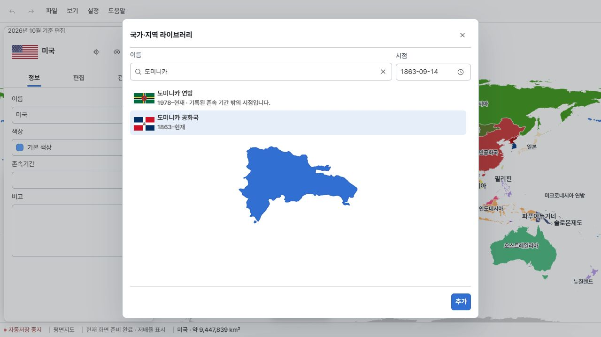
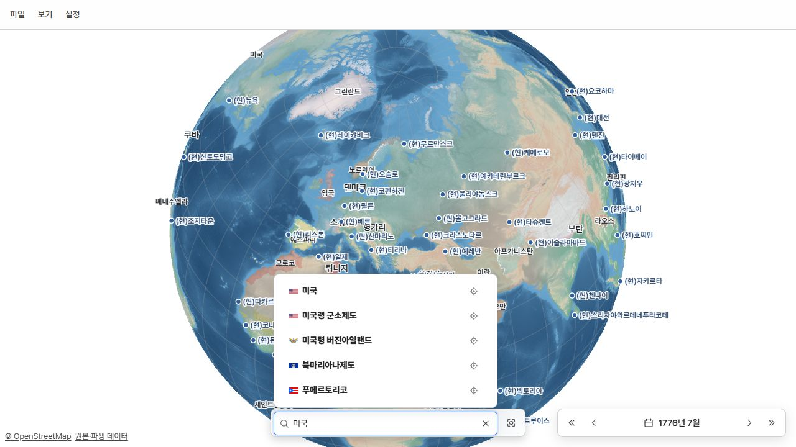

# 현존 정치체의 존속기간 보충

> ID: GEO-LIFE-EXTANT-20261025 · 최초 조사 2026-10-25 · 후속 조사·반영 2026-10-26 · 누적 100개 적용 / 52개 보류

현행 258개 중 시작일이 비어 있던 152개를 조사했다. 첫 반영 66개에 후속 34개를 더했다. 선택 대기 35개는 34개 반영과 태국 1개 보류로 정리했다. 태국은 정확한 월·일을 더 조사하라는 사용자 지시에 따라 비워 뒀다. 기존 51개 보류를 임의의 날짜로 채우지 않았다.

## 적용 기준

- 국가·정치체의 연속성을 우선한다. 국호·헌법·정권 변경만으로 새 시작을 만들지 않는다. 최신 연속 구간을 선택한 사례는 옛 구간을 한 기간으로 합치지 않는다.
- 식민지·속령은 상위 식민지에서 행정상 분리되어 별도로 구성된 때부터로 본다. 정착·단순 개칭·총독 교체만으로 시작하지 않는다. 개별적으로 사용자가 확정한 사건과 정책을 적용해 도출한 날짜를 출처 기록에서 구분했다.
- 확인된 연·월·일 정밀도를 유지한다. 입증된 구력은 그레고리력으로 환산하며 원래 날짜·달력을 보존한다. 영국은 Julian 1707-05-01을 Gregorian 1707-05-12로 기록했다.
- 국가 정본의 lifetime과 출처만 수정했다. 이번 34개의 좌표·형상 기간·부모 관계와 나머지 보호 필드는 보존했다. 현존 객체 종료일은 공란이다.
- 자료 생성과 자료 검사는 구분한다. 이번 데이터 검사는 선택한 34개와 직접 출력에 한정했다. 기본지도 부분 생성에는 관계로 연결된 186개 원본이 15개 묶음으로 필요했다.

## 지역별 현황

| 지역 | 조사 | 반영 | 선택 대기 | 보류 |
| --- | ---: | ---: | ---: | ---: |
| 유럽 | 35 | 28 | 0 | 7 |
| 아시아 | 37 | 24 | 0 | 13 |
| 북·중미·카리브해 | 29 | 16 | 0 | 13 |
| 남미 | 10 | 6 | 0 | 4 |
| 아프리카 | 17 | 10 | 0 | 7 |
| 오세아니아 | 22 | 15 | 0 | 7 |
| 미분류 | 2 | 1 | 0 | 1 |

## 실제 입력 날짜와 근거

아래는 누적 100개 입력값이다. 구체적인 후보·달력·본문 열람 여부는 research.json의 targets와 followUpResearch.entries에 남겼다. 출처의 검색 색인만 확인한 경우를 원문 전문 열람으로 표현하지 않는다.

| ID | 정치체 | 입력 | 선택 기준 | 출처 |
| --- | --- | --- | --- | --- |
| state:ALD | 올란드제도 | 1920-05-07 | 법적 자치 정체의 시작은 명시된 최초 자치법 시행일을 채택할 수 있다. 법 서명일 1920-05-06과 시행일 1920-05-07을 구분한다. 최초 법에 대한 현지의 불수용 때문에 기관 운영은 지연되었으며, 1921 국제합의와 1922 첫 개회는 별도 사건으로 보존한다. 그 이전의 지리적 지역 또는 보통 행정구역을 같은 자치 정체로 소급한 판정은 아니다. | [1](https://www.lagtinget.ax/sites/www.lagtinget.ax/files/alands_sjalvstyrelselag_124-1920.pdf) [2](https://www.lagtinget.ax/english/alands-lagting-parliament-aland) [3](https://www.lagtinget.ax/sites/www.lagtinget.ax/files/125-1920.pdf) |
| state:AND | 안도라 | 1278-09-15 | Government explicitly identifies 1278 as the Principality's birth; the French co-prince supplies the day. The earlier episcopal lordship is recorded in 1133. Later pareage, French co-lord relations and the 1993 constitution do not automatically restart the polity. | [1](https://www.govern.ad/ca/tematiques/cultura-i-esports/patrimoni-cultural/coneixer-el-patrimoni-cultural/historia-d-andorra) [2](https://www.coprince-fr.ad/fr/histoire-de-la-principaute) [3](https://ca.wikisource.org/wiki/Sent%C3%A8ncia_Arbitral_de_l%27any_1278_%28Primer_Pariatge_d%27Andorra%29) |
| state:AUT | 오스트리아 | 1945-04-27 | Latest restored republic only, as explicitly selected; earlier Austrian periods remain separate. | [1](https://www.parlament.gv.at/verstehen/historisches/1918-1945/geburt-der-republik) |
| state:BGR | 불가리아 | 1878-03-03 | User selected San Stefano national restoration rather than later treaty revision or full independence. | [1](https://government.bg/en/About-Bulgaria/HISTORY/tabsss1) |
| state:BIH | 보스니아헤르체고비나 | 1992-03-06 | User selected current independent state, excluding Yugoslav constituent period; UN succession records international responsibility from this date. | [1](https://www.bihconsulatesydney.com/we-are-celebrating-our-statehood-day-25-november/) |
| state:CHE | 스위스 | 1291-08 | User accepted the Federal Charter as conventional origin, not an attested first-ever alliance or invented August 1 signing day. | [1](https://www.admin.ch/de/bundesbrief-von-1291) |
| state:DEU | 독일 | 1867-07-01 | User explicitly included the North German federal state; 1871 expansion, 1919 regime and 1949 reorganisation do not restart this selected continuity. | [1](https://www.bundestag.de/webarchiv/presse/hib/2015_06/380964-380964) |
| state:ESP | 에스파냐 | 1716-01-16 | User chose Bourbon institutional integration rather than the 1479 personal union. This is the final Nueva Planta decree, not a single new-kingdom founding proclamation. | [1](https://descargas.intef.es/recursos_educativos/It_didac/Geo_Hist_ESO/2/07/03_La_Union_Dinastica/la_unin_dinstica_y_la_poltica_interior_de_los_rrcc.html) |
| state:FRA | 프랑스 | 0843 | User accepted West Francia after the Verdun partition as the conventional origin of the current polity; dynasty and republic changes do not restart it. | [1](https://www.vie-publique.fr/files/rapport/pdf/094000029.pdf) [2](https://www.assemblee-nationale.fr/dyn/histoire-et-patrimoine/revolution-francaise) |
| state:GBR | 영국 | 1707-05-12 | Lords opinion calls 1707 a new state; parliamentary regnal data separates Great Britain and United Kingdom. Government-commissioned Crawford/Boyle opinion discusses both new-state and enlarged-continuing-England interpretations. Follow the pending user choice among 1707, 1801 and blank; name change alone cannot decide. | [1](https://publications.parliament.uk/pa/ld199899/ldselect/ldprivi/108i/10806.htm) [2](https://api.parliament.uk/regnal-years/kingdoms) [3](https://assets.publishing.service.gov.uk/media/5a79e4fbed915d042206bcf5/Annex_A.pdf) |
| state:GGY | 건지섬 | 1204 | 건지 정부의 헌정 설명과 Jersey Legal Information Board의 설명이 모두 1204년을 현재 자치·사법독립 관계의 출발로 제시한다. 1066년은 노르망디 공작의 잉글랜드 왕위 취득이므로 건지의 신설일로 사용하지 않는다. 근거는 연도 정밀도이며 일·월을 만들어 붙이지 않는다. | [1](https://committees.parliament.uk/writtenevidence/125181/html/) [2](https://www.jerseylaw.je/publications/jglr/Pages/About.aspx) |
| state:GIB | 지브롤터 | 1713-07-13 | User selected legal cession under Utrecht Article X rather than the 1704 occupation; treaty dual date gives Gregorian July 13. | [1](https://www.gibmuseum.gi/our-history/brief-history-of-gibraltar) [2](https://publications.parliament.uk/pa/cm199899/cmselect/cmfaff/366/36615.htm) [3](https://www.gibraltar.gov.gi/press-releases/320-years-of-the-capture-of-gibraltar-5442024-10123) |
| state:GRC | 그리스 | 1822-01-13 | User selected the 1822 national constitution/declaration rather than 1830 recognition. Original Greek Julian January 1 is Gregorian January 13. | [1](https://200years.mfa.gr/en/international-treaties-en/) |
| state:HRV | 크로아티아 | 1991-10-08 | User selected independent Croatia, excluding constituent predecessors; Parliament distinguishes June 25 declaration from implementation and final severance after the Brioni moratorium. | [1](https://www.sabor.hr/en/about-parliament/history/important-dates/25-june-independence-day) |
| state:ISL | 아이슬란드 | 1918-12-01 | User selected modern sovereign-state restoration and left the 930 commonwealth as an earlier predecessor; 1944 republic is not a new start. | [1](https://www.althingi.is/pdf/Althingi2018_enska.pdf) [2](https://www.stjornarradid.is/rikisstjorn/sogulegt-efni/heimastjorn-1904-1918/leidin-til-sjalfstaedis/) |
| state:JEY | 저지섬 | 1204 | 저지 정부는 1204년에 부여된 자체 법에 따른 통치와 왕실 관계를 오늘날 헌정의 기초로 제시한다. 별도 자치 행정·법체계에 대한 공식 법률정보기관 설명과 일치한다. 1856·1948 의회 구성 변경은 정체 재성립으로 취급하지 않는다. 일·월은 근거가 없으므로 연도만 보존한다. | [1](https://www.gov.je/Leisure/Jersey/pages/history.aspx) [2](https://www.jerseylaw.je/publications/jglr/Pages/About.aspx) |
| state:KOS | 코소보 | 2008-02-17 | 이날 독립·주권국가를 선언한 분쟁 정치체. 보편적 승인일을 뜻하지 않음. | [1](https://kryeministri.rks-gov.net/en/news/kosovo-declaration-of-independence/) [2](https://www.srbija.gov.rs/vest/en/43154/government-decides-to-annul-illegal-acts-pertaining-to-declaration-of-kosovo-metohijas-unilateral-independence.php) |
| state:LIE | 리히텐슈타인 | 1719-01-23 | Government explicitly distinguishes creation of the Principality in 1719 from sovereignty in 1806. The merger creating this polity is supported to the day; 1806-07-12 changes the status of an already-existing principality. | [1](https://www.regierung.li/files/attachments/20251125-broschuere-begegnung-mit-einem-kleinstaat-639080401433496309.pdf) [2](https://www.300.li/wissenwertes/meilensteine-liechtensteins-geschichte) [3](https://www.e-archiv.li/textDetail.aspx?backurl=auto&eID=4&etID=46360) |
| state:LUX | 룩셈부르크 | 1815-06-09 | User selected the latest restoration under the Vienna Final Act, excluding the interrupted medieval duchy and French annexation interval. | [1](https://mint.gouvernement.lu/dam-assets/personnel-communal/recrutement-examen-d-admissibilite/programmes/Organisation-des-communes-admissibilite-B1-A-A2-A1.pdf) [2](https://luxembourg.public.lu/fr/societe-et-culture/histoire/renaissance-dun-pays.html) [3](https://luxembourg.public.lu/fr/societe-et-culture/histoire/400-ans-souverains-etrangers.html) |
| state:MCO | 모나코 | 1814-05-30 | User selected the latest restored principality; the Paris treaty restores pre-1792 relations. Earlier Grimaldi periods are not flattened through annexation. | [1](https://palais.mc/fr/l-institution/le-palais-des-princes-de-monaco-1-16.html) [2](https://www.imsee.mc/content/download/525246/6019179/file/Monaco%20en%20Chiffres%202024%20-%201.%20Territoire%20et%20Environnement.pdf) [3](https://www.gouv.mc/Gouvernement-et-Institutions/Histoire-et-Patrimoine/Epoques/Le-temps-des-difficultes-1793-1861/Annexion-a-la-France) |
| state:MKD | 북마케도니아 | 1991-09-17 | 1944부터 정치체 연속성 포함 여부 사용자 질문 중. 1991-09-08은 국민투표, 11-17은 헌법. | [1](https://www.sobranie.mk/deklaracii.nspx) |
| state:MNE | 몬테네그로 | 2006-06-03 | 옛 독립국 1878~1918 및 연방 정치체와 현재 구간 선택. 사용자 질문 중. | [1](https://www.muzejavnoj.ba/virtualna_tura/crna-gora-2/) |
| state:NLD | 네덜란드 | 1813-11-21 | User selected the latest restored state. The dated General Government proclamation and national archival entry establish November 21; distinguish assumption/proclamation from summaries of November 20. | [1](https://nationaalarchief.nl/beleven/onderwijs/bronnenbox/plakkaat-van-verlatinge-1581) [2](https://www.nationaalarchief.nl/onderzoeken/archief/2.01.01.01/download/pdf) [3](https://www.royal-house.nl/topics/history/history-of-the-kingdom-of-the-netherlands) |
| state:POL | 폴란드 | 1917-10-27 | User explicitly selected actual Regency Council rule, not the 1916 founding promise, September 1917 installation patent, or 1918 independent republic. | [1](https://zpe.gov.pl/a/a-strange-end-to-the-war-the-year-1918/D17qr0alf) |
| state:PRT | 포르투갈 | 1143 | User selected Zamora recognition as the origin. Use the government confirmed founding year without treating the traditional royal acclamation or recognition as an independently established exact creation day. | [1](https://portugal.gov.pt/pt/gc24/portugal/sobre-portugal) [2](https://portugal.gov.pt/gc25/comunicacao/noticias/governo-cria-comissao-para-celebrar-900-anos-da-fundacao-de-portugal) [3](https://www.visitguimaraes.travel/descobrir-guimaraes/personalidades-ilustres/d-afonso-henriques) |
| state:ROU | 루마니아 | 1859-02-05 | Modern state formation at the double election, not the later 1862 name/administrative consolidation. Apply the user selected Gregorian conversion to Julian January 24. | [1](https://www.mapn.ro/repere_istorice/) |
| state:SRB | 세르비아 | 2006-06-05 | User selected the current independent Serbian state interval. Use the National Assembly decision formally assuming successor-state powers; Montenegro declaration and dissolution background is June 3. | [1](https://www.parlament.gov.rs/narodna-skup%C5%A1tina/istorijat/posle-drugog-svetskog-rata.938.html) |
| state:TUR | 튀르키예 | 1920-04-23 | User explicitly selected Ankara national assembly/government and treats Ottoman state as predecessor rather than including its medieval origin. | [1](https://www.tbmm.gov.tr/history/) [2](https://www.ktb.gov.tr/EN-103908/biography-of-ataturk.html) [3](https://legal.un.org/riaa/cases/vol_I/529-614.pdf) [4](https://bilecik.gov.tr/osman-gazi) |
| state:AFG | 아프가니스탄 | 1747 | Modern state foundation explicitly supported; year precision. Later regime/status changes do not restart it. | [1](https://abudhabi.mfa.gov.af/en/afghanistan/) |
| state:BHR | 바레인 | 1783 | Current political formation1783 continues through protection and independence; source supports year only, not2002 kingdom reset. | [1](https://qdl.qa/en/historical-profile-bahrain) [2](https://www.moj.gov.bh/en/about-the-ministry/judicial-history) |
| state:CHN | 중화인민공화국 | 1949-10-01 | User explicitly selected PRC political identity, separately from ROC/Qing. | [1](https://www.locpg.gov.cn/zggq/2014-01/04/c_125956418.htm) |
| state:CYN | 북키프로스 | 1983-11-15 | 공화국 선포를 사용자가 선택 | [1](https://www.mfa.gov.ct.tr/pages/historical-perspective) [2](https://digitallibrary.un.org/record/723953/files/A_7201-EN.pdf) [3](https://digitallibrary.un.org/record/636017/files/S_INF_31-EN.pdf) [4](https://documents.un.org/api/symbol/access?l=fr&s=S%2FRES%2F541+%281983%29&t=pdf) [5](https://pio.mfa.gov.ct.tr/en/the-concrete-expression-of-our-sovereignty-and-independence-the-trnc-turns-40-today/) |
| state:ESB | 데켈리아 | 1960-08-16 | Dhekelia as separate base territory begins under 1960 treaty; do not backdate to all British Cyprus. | [1](https://treaties.un.org/Pages/showDetails.aspx?clang=_en&objid=08000002801388ac) [2](https://treaties.un.org/doc/Publication/UNTS/Volume%20382/v382.pdf) [3](https://www.gov.uk/government/publications/permanent-joint-operating-bases-pjobs/fd) [4](https://www.legislation.gov.uk/uksi/1960/1369/pdfs/uksi_19601369_en.pdf) |
| state:HKG | 홍콩 | 1843-06-26 | 별도 식민지 구성 기준에 따른 홍콩 식민지 헌장 현지 공포 | [1](https://www.police.gov.hk/museum/qrpage/en/inner/2/2.html) [2](https://www.legco.gov.hk/en/about-legco/history-art-and-architecture.html) [3](https://www.basiclaw.gov.hk/en/basiclaw/preamble.html) [4](https://www.legco.gov.hk/1966/h660105.pdf) |
| state:IRN | 이란 | 1501 | User explicitly selected Safavid reunification in 1501 as the current polity origin; do not merge earlier interrupted Persian empires or restart for the 1979 regime. | [1](https://tile.loc.gov/storage-services/master/frd/copr/Iran.pdf) [2](https://history.state.gov/countries/iran) |
| state:IRQ | 이라크 | 1921 | Iraq government submission explicitly identifies state establishment in1921. No supported founding month/day; republic and mandate end do not restart polity. | [1](https://documents.un.org/doc/undoc/gen/g19/351/45/pdf/g1935145.pdf) [2](https://mofa.gov.iq/delhi/?lang=en&p=1741) |
| state:JOR | 요르단 | 1921-04-11 | Official government separates emirate founding from independence; retain continuity through constitutional and status changes. | [1](https://jordan.gov.jo/EN/Pages/Hashemite_Monarchs_of_Jordan) |
| state:KAB | 바이코누르 | 1995-09-25 | 임차 복합체 계약 발효일을 사용자 확정 | [1](https://adilet.zan.kz/rus/docs/H040000430_) [2](https://old.adilet.zan.kz/rus/docs/U950002195_/compare) |
| state:KHM | 캄보디아 | 1841 | 사용자가 1841년을 선택했다. 앙두엉이 여러 지방에 관료와 군 지휘관을 배치하고, 늦어도 그해 말에는 북부의 영토 정부로 작동한 시기를 현존 객체의 대표 기원으로 삼는다. 정확한 개시 월일은 미상이며 우동 도착일·프놈펜 이전일·대관식 날짜로 대체하지 않는다. 802년부터의 무중단 연속성을 확정한 것은 아니다. | [1](https://www.cambodiaembassyuk.org/information-for-visitors/) [2](https://history.state.gov/countries/cambodia) [3](https://thesiamsociety.org/wp-content/uploads/1972/03/JSS_060_1d_Chandler_CambodiaRelationsWithSiamInEarlyBangkokPeriod.pdf) |
| state:LBN | 레바논 | 1920-09-01 | Greater Lebanon continues through republic and independence. Earlier Mount Lebanon regime was abolished during WWI, so do not flatten across that interruption. | [1](https://www.lebarmy.gov.lb/ar/node/771) [2](https://www.mfa.gov.lb/SubPage.aspx?PageID=125) |
| state:MAC | 마카오 | 1844-09-20 | 포르투갈령 인도에서 분리한 마카오 중심 주 구성 왕령 | [1](https://www.icm.gov.mo/rc/viewer/20023/1089) [2](https://www.icm.gov.mo/rc/viewer/20022/1073) [3](https://www.library.gov.mo/zh-hans/chnoldbook) [4](https://treaties.un.org/pages/historicalinfo.aspx) [5](https://www.icm.gov.mo/rc/viewer/10098/2177) |
| state:MNG | 몽골 | 1921-02-22 | 1919 정부 해체 후 최신 복원 구간으로 사용자가 확정 | [1](https://gd.china-embassy.gov.cn/eng/zxhd_1/201908/t20190820_3489312.htm) [2](https://history.state.gov/countries/mongolia) [3](https://montsame.mn/jp/read/358540) [4](https://www.gov.mn/news/n/92f5) |
| state:MYS | 말레이시아 | 1963-09-16 | 말라야를 별도 전신으로 하는 사용자 선택 | [1](https://repositori.parlimen.gov.my/handle/123456789/3695) [2](https://treaties.un.org/pages/historicalinfo.aspx) [3](https://www.parlimen.gov.my/maklumat-umum.html?%3B=&%3B_print=true&lang=en&uweb=dn) [4](https://pustakailmu.arkib.gov.my/index.php/ms/pustaka-ilmu/jendela-sejarah/penubuhan-malaysia-16-september-1963) |
| state:NPL | 네팔 | 1768 | 통합 네팔 기원 연도 선택; 정밀도 임의 확장 안 함 | [1](https://tile.loc.gov/storage-services/master/frd/copr/Nepal.pdf) [2](https://trade.ntb.gov.np/know-nepal/nepals-history/) [3](https://mofa.gov.np/pages/introduction-10/) |
| state:PAK | 파키스탄 | 1947-08-15 | Direct original law specifies15th;14th transfer ceremony differs. Ask which event; do not lower precision to hide conflict.1956 republic not restart. | [1](https://www.legislation.gov.uk/ukpga/Geo6/10-11/30/pdfs/ukpga_19470030_en.pdf) [2](https://na.gov.pk/en/content.php/content.php?id=75) |
| state:PSX | 팔레스타인 | 1988-11-15 | For included disputed states use directly read declaration; distinguish PA administrative institution and later UN status. | [1](https://documents.un.org/api/symbol/access?l=en&s=A%2F43%2F827&t=pdf) [2](https://documents.un.org/api/symbol/access?l=en&s=A/RES/67/19&t=pdf) [3](https://www.un.org/unispal/document/auto-insert-197680/) |
| state:QAT | 카타르 | 1878-12-18 | 사용자가 명시한 대표 기원 | [1](https://diwan.gov.qa/about-qatar/qatars-rulers/sheikh-mohammed-bin-thani?sc_lang=en) [2](https://www.diwan.gov.qa/en/about-qatar/qatars-rulers/sheikh-jassim-bin-mohammed-bin-thani) [3](https://diwan.gov.qa/en/About-Qatar/History-of-Qatar) [4](https://www.almeezan.qa/LawView.aspx?LawID=2479&language=en&opt=) |
| state:SAU | 사우디아라비아 | 1925-12-21 | User selected the polity after annexing Hail and Hejaz. Contemporary December 22 telegram 73 says Jeddah officially surrendered yesterday; December 22 in telegram 72 is Ali departure, not the surrender. | [1](https://www.mofa.gov.sa/en/ksa/Pages/history.aspx) |
| state:TWN | 중화민국 | 1912-01-01 | User explicitly selected ROC political identity; later relocation does not restart it. | [1](https://english.president.gov.tw/page/49) |
| state:VNM | 베트남 | 1945-09-02 | User explicitly selected Democratic Republic of Vietnam declaration as this current entity origin, treating earlier dynastic polities as predecessors. | [1](https://mofa.gov.vn/lich-su1) |
| state:WSB | 아크로티리 | 1960-08-16 | Akrotiri as separate base territory begins under 1960 treaty; do not backdate to all British Cyprus. | [1](https://treaties.un.org/Pages/showDetails.aspx?clang=_en&objid=08000002801388ac) [2](https://treaties.un.org/doc/Publication/UNTS/Volume%20382/v382.pdf) [3](https://www.gov.uk/government/publications/permanent-joint-operating-bases-pjobs/fd) [4](https://www.legislation.gov.uk/uksi/1960/1369/pdfs/uksi_19601369_en.pdf) |
| state:YEM | 예멘 | 1990-05-22 | Agreement and joint notice specify single state merger; distinguish earlier independent northern/southern states and2006registration. | [1](https://treaties.un.org/Pages/showDetails.aspx?objid=0800000280067a61) [2](https://treaties.un.org/pages/historicalinfo.aspx) |
| state:AIA | 앵귈라 | 1980-12-19 | 별도 영토의 법적 분리 | [1](https://cdn.nationalarchives.gov.uk/documents/migrated-archives-guidance.pdf) [2](https://gov.ai/service/about-anguilla/anguilla-history) [3](https://digitallibrary.un.org/record/71405/files/A_AC-109_799-EN.pdf) |
| state:BMU | 버뮤다 | 1612 | Official governor succession begins1612, distinct from1609 shipwreck; Company/Crown transition does not restart. | [1](https://www.gov.bm/previous-governors-bermuda) |
| state:CAN | 캐나다 | 1867-07-01 | Three distinct colonies form new Dominion;prior Canada divides intoOntario/Quebec. Later independence powers not restart. | [1](https://laws.justice.gc.ca/eng/const/page-1.html) [2](https://www.canada.ca/en/canadian-heritage/campaigns/canada-day/about/dominion-day/newspaper-extracts.html) |
| state:CLP | 클리퍼턴섬 | 1858-11-17 | As a separately listed dependency rather than sovereign country, use verified continuing French territorial jurisdiction. Discovery1711, Mexican occupation and1931 adjudication are not new polity founding dates. Award specifically distinguishes lack of local administration from loss of territorial title. | [1](https://legal.un.org/riaa/cases/vol_II/1105-1111.pdf) |
| state:DOM | 도미니카 공화국 | 1863-09-14 | 복원정부부터 이어지는 최신 구간을 사용자 확정 | [1](https://mirex.gob.do/historia-rd/) [2](https://presidencia.gob.do/sites/default/files/decree/2021-03/Decreto%20146-21.pdf) [3](https://www.tribunalconstitucional.gob.do/sala-de-prensa/noticias/presidente-del-tc-destaca-influencia-de-la-guerra-de-la-restauraci%C3%B3n-en-la-constituci%C3%B3n-dominicana/) [4](https://colecciones.agn.gob.do/opac/busca.php?codopac=OPPUB&formTipo=0&materia=GUERRA) |
| state:GRL | 그린란드 | 1721 | Official Denmark MFA identifies modern colonial origin1721;medievalNorse settlement not continuously merged. | [1](https://um.dk/japan/en/about-denmark/greenland/history-and-culture/) |
| state:GTM | 과테말라 | 1839-04-17 | 연방 탈퇴라는 사용자 선택에 대응 | [1](https://www.cervantesvirtual.com/obra-visor/constitucion-politica-del-estado-de-guatemala-de-1825/html/ef014f81-0322-4b73-88de-0bdeb99f49ac_2.html) [2](https://history.state.gov/countries/guatemala) [3](https://www.auswaertiges-amt.de/en/aussenpolitik/regionaleschwerpunkte/lateinamerika/2480956-2480956) [4](https://dca.gob.gt/noticias-guatemala-diario-centro-america/el-amanecer-de-los-estados-centroamericanos/) |
| state:MAF | 생마르탱 | 1648 | French distinct territory from1648; not reset by municipal/COM status. Official13/23March day spellings unresolved; year confirmed. | [1](https://www.com-saint-martin.fr/thematiques/emploi_formation/emploi_et_apprentissage/offres_emploi/et-O971261014000002) [2](https://www.com-saint-martin.fr/thematiques/organisation-territoriale/votre-collectivite/histoire-de-la-collectivite) [3](https://www.saint-barth-saint-martin.gouv.fr/contenu/telechargement/1250/10623/file/3_Note%20M%C3%A9thodologique.pdf) |
| state:MEX | 멕시코 | 1821-09-28 | 멕시코 제국 독립선언과 임시정부 구성 | [1](https://nuevaescuelamexicana.sep.gob.mx/contenido/coleccion/el-virreinato-i-2/) [2](https://nuevaescuelamexicana.sep.gob.mx/contenido/coleccion/18773/) [3](https://www.gob.mx/agn/articulos/archivisticaclio-documentos-de-la-consumacion-de-la-independencia-de-mexico?idiom=es) |
| state:MSR | 몬트세랫 | 1632 | White Paper says colony established1632, not merely settlement; occupation/constitutional reform no automatic restart. | [1](https://assets.publishing.service.gov.uk/media/5a75afa4ed915d506ee80b87/ot-wp-0612.pdf) |
| state:SLV | 엘살바도르 | 1841-02-02 | 독립 선언과 2월18일 헌법을 구별 | [1](https://www.cervantesvirtual.com/obra-visor/constitucion-politica-de-la-republica-de-el-salvador-de-1824/html/9215c899-4b99-40cf-8960-f18fb644c894_2.html) [2](https://www.presidencia.gob.sv/wp-content/uploads/2021/09/EXPOSICIO%CC%81N-DE-MOTIVOS-FINAL-1.pdf) [3](https://history.state.gov/countries/el-salvador) [4](https://memoria.ues.edu.sv/linea-de-tiempo/la-fundacion-de-la-ues-y-los-primeros-anos-de-su-existencia/) |
| state:SXM | 신트마르턴 | 1648 | Earlier whole-island occupation not continuous current southern polity. Day13/23March calendar not proved; year partition confirmed. | [1](https://www.com-saint-martin.fr/thematiques/emploi_formation/emploi_et_apprentissage/offres_emploi/et-O971261014000002) [2](https://sintmaartengov.org/Documents/Translated%20Legislation/AB%201_MvT%20Staatsregeling.pdf) [3](https://www.gobierno.aw/historia-di-reino-hulandes-y-aruba) |
| state:TCA | 터크스케이커스제도 | 1962-08-06 | 자메이카 종속 이후 최신 별도 식민지 구간 | [1](https://parliament.gov.tc/history-of-parliament) [2](https://cdn.nationalarchives.gov.uk/documents/migrated-archives-8-tranche-guide.pdf) [3](https://www.legislation.gov.uk/uksi/1962/1649/pdfs/uksi_19621649_en.pdf) |
| state:USA | 미국 | 1776-07-04 | 국가 연속성과 독립선언서 채택일을 사용자 확정 | [1](https://history.state.gov/milestones/1776-1783/continental-congress) [2](https://www.archives.gov/milestone-documents/declaration-of-independence) [3](https://www.archives.gov/milestone-documents/articles-of-confederation) [4](https://www.archives.gov/founding-docs/constitution-transcript) [5](https://www.archives.gov/founding-docs/timeline) |
| state:USG | 관타나모만 해군 기지 | 1903-02-23 | 구안타나모 임대 합의 양측 서명 완료 | [1](https://history.state.gov/historicaldocuments/frus1911/d110) [2](https://history.state.gov/historicaldocuments/frus1911/d111) [3](https://cnrse.cnic.navy.mil/Installations/NS-Guantanamo-Bay/About/History/) [4](https://history.state.gov/historicaldocuments/frus1903/d331) |
| state:VIR | 미국령 버진아일랜드 | 1672 | NARA explicitly connects1672 company government to current territorial predecessor/successor administrations. Exact first operating day unconfirmed. | [1](https://www.archives.gov/research/guide-fed-records/groups/055.html) [2](https://www.nps.gov/viis/learn/timeline.htm) [3](https://www.archives.gov/philadelphia/finding-aids/us-virgin-islands) |
| state:ARG | 아르헨티나 | 1831-01-04 | 아르헨티나 연맹을 별도 시작으로 사용자 확정 | [1](https://buenosaires.gob.ar/gcaba_historico/laciudad/calendario-historico/agosto) [2](https://www.electoralmisiones.gov.ar/25-de-mayo-dia-de-la-patria-3/) [3](https://www.argentina.gob.ar/sites/default/files/2025/07/acta_de_la_independencia_-_castellano.pdf) [4](https://institutorosas.cultura.gob.ar/noticia/documento-completo-sobre-la-firma-del-pacto-federal/) |
| state:BOL | 볼리비아 | 1825-08-06 | EarlierCharcas/provincial jurisdictions areantecedents. Confederation lawretainsBolivianindependence/government;no1836/39restart. | [1](https://www.ine.gob.bo/index.php/bolivia/aspectos-historicos/) [2](https://www.leyes.congreso.gob.pe/Documentos/constituciones_ordenado/CONSTIT_1837/Lcpb1837.pdf) |
| state:COL | 콜롬비아 | 1831-11-21 | Currentcontinuingspell beginsnewstateafterGranColombiadissolution. Originalnewstate/proportionaldebt succession explicit;laternamesnotrestart. | [1](https://www.alcaldiabogota.gov.co/sisjur/normas/Norma1.jsp?i=13693&dt=S) [2](https://www.senalmemoria.co/piezas/asi-termino-la-gran-colombia) [3](https://www.camara.gov.co/que-es-la-camara/historia/) |
| state:FLK | 포클랜드제도 | 1843-06-23 | 별도 식민지 구성 헌장 기준 | [1](https://cancilleria.gob.ar/es/politica-exterior/cuestion-malvinas/antecedentes/antecedentes-historicos) [2](https://laws.gov.gs/1775-1908-arrangements/) [3](https://nationalarchives.gov.fk/jdownloads/Government/The%20Beginning%20of%20the%20Legislative%20Assembly.pdf) |
| state:SGS | 사우스조지아사우스샌드위치제도 | 1985-10-03 | 별도 해외영토 구성 | [1](https://laws.gov.gs/wp-content/uploads/2022/05/1985.pdf) [2](https://laws.gov.gs/1775-1908-arrangements/) [3](https://laws.gov.gs/1908-1948-arrangements/) [4](https://laws.gov.gs/secondary-legislation/) |
| state:URY | 우루과이 | 1828-08-27 | 평화협약 서명일 선택;27일 대28일 대조 | [1](https://www.gub.uy/ministerio-educacion-cultura/comunicacion/noticias/gesta-del-25-agosto-1825) [2](https://www.gub.uy/ministerio-educacion-cultura/comunicacion/noticias/25-agosto-1825-declaratoria-independencia-0) [3](https://www.gub.uy/ministerio-educacion-cultura/comunicacion/noticias/25-agosto-fecha-para-celebrar-nuestra-historia-nuestro-patrimonio) [4](https://palacio.parlamento.gub.uy/rese%C3%B1a_parlamentaria) [5](https://www.dipublico.org/122033/) [6](https://pmb.parlamento.gub.uy/pmb/opac_css/doc_num.php?explnum_id=96) |
| state:CMR | 카메룬 | 1960-01-01 | 독립일 기준 사용자 선택 | [1](https://www.diplocam.cm/histoire/) [2](https://www.legifrance.gouv.fr/jorf/id/JORFTEXT000000325643/) [3](https://prc.cm/fr/actualites/discours/510-message-du-chef-de-l-etat-a-la-nation-a-l-occasion-de-la-celebration-des-cinquantenaires-de-l-independance-et-de-la-reunification-du-cameroun?highlight=WzIwMTBd) [4](https://www.prc.cm/fr/actualites/discours/510-message-du-chef-de-l-etat-a-la-nation-a-l-occasion-de-la-celebration-des-cinquantenaires-de-l-independance-et-de-la-reunification-du-cameroun) |
| state:DZA | 알제리 | 1962-07-03 | 주권 이전일로 사용자 확정 | [1](https://hudoc.echr.coe.int/app/conversion/docx/html/body?id=001-231874&library=ECHR) [2](https://www.joradp.dz/FTP/Jo-Francais/1962/F1962001.pdf) [3](https://www.joradp.dz/FTP/Jo-Francais/1962/F1962901.pdf) [4](https://www.cheminsdememoire.gouv.fr/fr/revue/1962-fin-de-guerre-en-algerie) |
| state:ERI | 에리트레아 | 1993-05-24 | 공식 독립일 기준 선택 | [1](https://www.normattiva.it/atto/caricaDettaglioAtto?atto.codiceRedazionale=090U6592&atto.dataPubblicazioneGazzetta=1890-01-07&qId=&tipoDettaglio=multivigenza) [2](https://legal.un.org/riaa/cases/vol_XXVI/195-247.pdf) [3](https://shabait.com/2019/05/15/may-in-the-history-of-eritrea/) [4](https://shabait.com/2023/04/24/message-of-fm-osman-saleh/) |
| state:IOT | 영국령 인도양 지역 | 1965-11-08 | Currentseparateterritory,notearlierMauritiusdependency. Date doesnot adjudicate legitimacy/decolonisation.2025treaty signingnotentryintoforce;2026officials stilllistBIOT. | [1](https://data.jncc.gov.uk/data/76235f1f-45a2-49d3-8290-41eccb4cc25a/jncc-biodiversity-ots-1999.pdf) [2](https://hansard.parliament.uk/Lords/2026-10-13/debates/4ede4a99-dcfd-405b-8e42-1c2ae6fee08e/LordsChamber) [3](https://www.legislation.gov.uk/uksi/2026/1089/made?view=plain) |
| state:SAH | 서사하라 | 1976-02-27 | 사용자 독립일 기준에 대응하는 SADR 선포 | [1](https://documents.un.org/api/symbol/access?l=en&s=S%2F2002%2F161&t=pdf) [2](https://achpr.au.int/sites/default/files/files/2026-05/sahrawi-republic-combined-periodical-reports-2013-2025eng.pdf) [3](https://au.int/sites/default/files/newsevents/workingdocuments/13174-wd-legal_opinionof-the-auc-legal-counsel-on-the-legality-of-the-exploitation-and-exploration-by-foreign-entities-of-the-natural-resources-of-western-sahara.pdf) |
| state:SEN | 세네갈 | 1960-08-20 | 말리연방 탈퇴 후 별도 국가로 사용자 확정 | [1](https://www.cvce.eu/content/publication/2015/10/29/819ad60b-df3d-4347-bfcc-803e9b4e1919/publishable_fr.pdf) [2](https://archivesdusenegal.gouv.sn/?page_id=2025) [3](https://www.villedesaintlouis.org/municipalite_historique.php) [4](https://archivesdiplomatiques.diplomatie.gouv.fr/ark%3A/14366/5jfsg3w6z48h) |
| state:SHN | 세인트헬레나 | 1659 | Constitutionpreambletracescontinuouslegalterritorialhistoryto1659. Crowntransfer/newconstitutionnotrestart. TourismDutchoccupationyear1665conflictswithofficialheritage1673;notusedasfoundingproof. | [1](https://www.sainthelena.gov.sh/documents/constitution-of-st-helena-ascension-and-tristan-da-cunha-2009-updated-180620-2.pdf) [2](https://www.sainthelena.gov.sh/st-helena/government/legislation/general-introduction/) |
| state:SOL | 소말릴란드 | 1991-05-18 | User selected current restored independence only; do not join the June 26-July 1 1960 independent interval through the union with Somalia. | [1](https://www.govsomaliland.org/uploads/files/2024/05/2024-05-27-07-48-50-8295-1716796130.pdf) |
| state:TZA | 탄자니아 | 1964-04-26 | Lawcreatesnewunitedsovereignrepublic;Tanganyikaseparategovernmentconstitutionends. LaterTanzanianamenotreset. | [1](https://www.chragg.go.tz/uploads/documents/sw-1669286994-22-1964%20The%20Union%20of%20Tanganyika%20and%20Zanzibar%20Act.pdf) [2](https://www.tanzania.go.tz/topics/union-matters) |
| state:ZAF | 남아프리카 공화국 | 1910-05-31 | Fourcoloniesformnewstate;Cape/Boerantecedentsnotretroactivelyonecountry.1961/1994notrestart. | [1](https://www.concourt.org.za/index.php/constitution/history) [2](https://www.gov.za/about-sa/history) |
| state:ASM | 미국령 사모아 | 1900-02-16 | 미국령 사모아의 별도 국제적 귀속 구간 선택 | [1](https://www.archives.gov/federal-register/codification/executive-order/10264.html) [2](https://asamoandigitalarchives.omeka.net/collections/show/12) [3](https://fam.state.gov/fam/08FAM/08FAM030802.html) |
| state:ATC | 애시모어카르티에제도 | 1934-05-10 | Exactcombinedterritoryacceptance,notearlierseparateislandclaimsorActMay3.1978administrationnotrestart. | [1](https://www.legislation.gov.au/C1933A00060/2008-07-04/2008-07-04/text/original/epub/OEBPS/document_1/document_1.html) [2](https://www.infrastructure.gov.au/territories-regions/territories/ashmore-and-cartier-islands) |
| state:AUS | 오스트레일리아 | 1901-01-01 | Sixseparatecoloniesformnewstate;laterindependencepowersnotreset. | [1](https://www.legislation.gov.au/files/gazettes/historic/1901/1901GN01.pdf) [2](https://peo.gov.au/understand-our-parliament/history-of-parliament/federation/federation) |
| state:COK | 쿡제도 | 1965-08-04 | 뉴질랜드에서 자치국으로 분리된 현 구간 선택 | [1](https://nzhistory.govt.nz/cook-islands-achieves-self-government) [2](https://natlib.govt.nz/records/22619871) [3](https://paperspast.natlib.govt.nz/parliamentary/AJHR1891-II.2.1.2.4) [4](https://www.legislation.govt.nz/act/public/1964/69/en/latest/) |
| state:CSI | 산호해제도 | 1969-09-30 | Act3explicitlyformsoneterritory;earlierclaims/stationsnotpolitybirth.1997extensionnotrestart. | [1](https://www.legislation.gov.au/C1969A00058/2022-06-02/2022-06-02/text/original/epub/OEBPS/document_1/document_1.html) [2](https://www.infrastructure.gov.au/territories-regions/territories/coral-sea-islands) |
| state:FSM | 미크로네시아 연방 | 1979-05-10 | Presidentexplicitlycalls1979newfederationformation;1986statusnotfirststate. | [1](https://www.fsmgov.org/const25.htm) |
| state:GUM | 괌 | 1899-04-11 | 마리아나에서 분리된 미국령 괌; 자치정부일이 아님 | [1](https://home.nps.gov/articles/000/assan-through-the-ages.htm) [2](https://www.doi.gov/oia/islands/guam) [3](https://uscode.house.gov/us/usc/119-124/t48/s1421/) |
| state:HMD | 허드맥도널드제도 | 1953-04-24 | 별도 단일 영토 구성 법률 시행 | [1](https://www.dfat.gov.au/about-us/publications/historical-documents/Pages/volume-12/584-declaration-by-campbell) [2](https://www.legislation.gov.au/C1953A00007/2008-07-04/2008-07-04/text/original/epub/OEBPS/document_1/document_1.html) [3](https://www.legislation.gov.au/C1953A00007/asmade/1953-03-27/text/original/pdf) |
| state:NCL | 누벨칼레도니 | 1853-09-24 | Actualdependentgovernment1853beginscurrentinterval;1860/1946statusnotreset.1844attemptwithdrawn. | [1](https://isee.nc/histoire-et-institutions) [2](https://www.senat.fr/rap/1976-1977/i1976_1977_0163.pdf) [3](https://museemaritime.nc/images/musee/actualites/Dossiers_Pedagogiques_Expo_Temp/Dossier_Pedag_Lycee_Seine_Corrige.pdf) |
| state:NFK | 노퍽섬 | 1856-11-01 | Official1979ActpreambleexplicitlystatesseparationfromTasmaniaeffectiveNSWproclamation1856-11-01;lateradministration/Australiantransfernotbirth. | [1](https://www.legislation.gov.au/C2004A02035/2005-02-22/2005-02-22/text/original/epub/OEBPS/document_1/document_1.html) [2](https://www.infrastructure.gov.au/sites/default/files/documents/nirc-public-inquiry-final-report.pdf) |
| state:NZL | 뉴질랜드 | 1841-05-03 | 뉴사우스웨일스에서 별도 식민정부 구성 | [1](https://nzhistory.govt.nz/media/interactive/he-whakaputanga-declaration-independence-1835) [2](https://teara.govt.nz/en/biographies/1h29/hobson-william) [3](https://teara.govt.nz/en/zoomify/32912/declaration-of-independence) [4](https://www.nma.gov.au/defining-moments/resources/new-zealand-becomes-a-separate-colony) |
| state:PGA | 웨이크섬 | 1899-01-17 | Wakeofficialterritorycurrentintervalbegins1899;lateragencychange andWWIImilitaryoccupationnotnewstate. Date notadjudicationofMarshallclaim. | [1](https://tile.loc.gov/storage-services/master/pnp/habshaer/um/um0000/um0061/data/um0061data.pdf) [2](https://www.presidency.ucsb.edu/documents/executive-order-6935-placing-certain-islands-the-pacific-ocean-under-the-control-and) |
| state:PYF | 프랑스령 폴리네시아 | 1880-12-30 | 할양 비준·식민 법률을 사용자 확정 | [1](https://www.arue.pf/patrimoines/le-cimetiere-familial-pomare/) [2](https://www.assemblee-nationale.fr/11/rapports/r1665.asp) [3](https://www.assemblee-nationale.fr/13/rapports/r0417.asp) [4](https://www.assemblee-nationale.fr/15/pdf/rapports/r1820.pdf) |
| state:TON | 통가 | 1845 | 현존 통합왕국의 시작을 사용자 확정 | [1](https://history.state.gov/countries/tonga) |
| state:WLF | 왈리스푸투나 | 1909-06-10 | 공동 행정·재정 조직 법령으로 사용자 확정 | [1](https://www.economie.gouv.fr/daj/lettre-de-la-daj-rapport-de-la-cour-des-comptes-sur-le-territoire-de-wallis-et-futuna-les) [2](https://www.outre-mer.gouv.fr/territoires/wallis-et-futuna) [3](https://www.ieom.fr/IMG/pdf/ra2008_wallis_et_futuna.pdf) [4](https://www.senat.fr/rap/r14-103/r14-1030.html) [5](https://www.senat.fr/comptes-rendus-seances/3eme/pdf/documents_parlementaires/1914/DP1914_413_512.pdf) |
| state:ATF | 프랑스령 남방 및 남극 | 1955-08-06 | 마다가스카르에서 분리한 창설 법률의 공식 기준일 권고 | [1](https://taaf.fr/collectivites/presentation/) [2](https://www.legifrance.gouv.fr/jorf/id/JORFTEXT000000879815) [3](https://www.insee.fr/fr/information/7929495) [4](https://taaf.fr/actualite/ce-6-aout-2020-les-terres-australes-et-antarctiques-francaises-ont-65-ans/) |

## 보류 대상과 사유

| ID | 정치체 | 지역 | 보류 사유 |
| --- | --- | --- | --- |
| state:DNK | 덴마크 | 유럽 | Royal genealogy reaches Gorm, who died circa 958; that is not a founding date. Absolutism in 1660-1661 and the 1849-06-05 constitution changed an existing monarchy. No actual polity founding year or day is established by the opened source. |
| state:FRO | 페로제도 | 유럽 | 최초 독자 정치공동체의 성립일은 확정하지 않는다. 공식 의회는 의회 기원을 약 800년경 정착 직후라는 추정으로 설명하고 최초 문헌을 약 1200년 작성 사가로 제시한다. 정착·노르웨이 왕에게의 복속·행정개편·1948 자치 확대 가운데 하나를 최초 정체 창설로 자동 치환할 수 없다. 약 800년경 기원은 검증된 ISO 연도로 입력하지 않는다. |
| state:HUN | 헝가리 | 유럽 | 국가 기원의 단일 실제 성립일 미확정. 1000-12-25/1001-01-01 대관식 전승을 임의 선택하지 않음. |
| state:IMN | 맨섬 | 유럽 | 공식 의회가 전통적 979년의 증거 부족을 직접 인정한다. 1079 정복, 1266 양도, 1765 환수는 각각 왕조·지배권 사건이며 최초 독자 정치공동체의 확정 기원이 아니다. 노르드 행정체계가 지배권 변경 동안 이어졌다는 공식 설명이 있으므로 가장 최근의 지위 변경만으로 시작일을 고르지 않는다. |
| state:NOR | 노르웨이 | 유럽 | 실제 열린 왕실 자료가 Harald의 통합을 9세기 말로 설명하고 초기 왕의 정확한 연대와 872년 전통의 불확실성을 인정한다. 9세기 말이라는 범위를 근거 없는 단일 ISO 연도로 바꾸지 않는다. 1814 헌법과 1905 연합 해소는 국가·정체의 계속성과 구별해서 기록하되, 최초 기원을 확정할 증거로 취급하지 않는다. |
| state:SMR | 산마리노 | 유럽 | Official history labels 301 origin a legend. The 885 document establishes an existing organized community; 1243 records first consuls and 1253 early statutes. None proves the actual founding date. Do not reverse-engineer 0301-09-03 from the September 3 commemoration. |
| state:SWE | 스웨덴 | 유럽 | Royal Court describes continuous monarchy since the tenth century without a founding year or day. Parliament's 1523-06-06 is Gustav Vasa's election and Sweden's departure from the Kalmar Union. That cannot automatically replace earlier polity continuity; do not convert a century into an invented year. |
| state:BRN | 브루나이 | 아시아 | Earlier sultanate existed;14c Islamisation/first Muslim ruler does not prove first polity. Protection/independence do not restart it. |
| state:BTN | 부탄 | 아시아 | Arrival is not completed unification;17c process has no confirmed exact year; monarchy not first polity. |
| state:CNM | 유엔 키프로스 완충 지대 | 아시아 | UN 정전 감시 완충구역이며 독립 정치체 창설일로1974 정전일을 입력하지 않음. |
| state:JPN | 일본 | 아시아 | Government holiday page establishes commemoration, not historical founding year. No mythical660BCE/date manufactured. |
| state:KAS | 시아첸빙하 | 아시아 | 시아첸 빙하/분쟁 지형으로 별도 정치체가 아님. 군사작전일을 창설일로 대체하지 않음. |
| state:KWT | 쿠웨이트 | 아시아 | Official sources disagree about settlement, first ruler and government origins. Do not resolve historical contradictions by arbitrary user preference or substitute later independence. |
| state:LAO | 라오스 | 아시아 | Divided kingdoms and modern reunification must be checked; no continuous1353 interval manufactured or1975 regime reset. |
| state:MDV | 몰디브 | 아시아 | Religious change1153 is not first political existence; pre-Islam history uncertain. Do not substitute later protection/independence. |
| state:OMN | 오만 | 아시아 | 1650 concerns some coastal areas;1744 is dynasty change. Earlier independent kings/imams confirmed but initial state date and continuity remain unsupported. |
| state:PHL | 필리핀 | 아시아 | Cannot make ended1898-1901 republic continuous. Colonial administration/Commonwealth/current republic identity needs decision;1935-46 continuity supported. |
| state:SCR | 스카버러암초 | 아시아 | 분쟁 암초 지형이며 별도 정치체의 창설 사건 근거 없음. 지배권·보호구역 지정일과 구분. |
| state:SYR | 시리아 | 아시아 | Union1958-1961 distinguishes separate existence from treaty continuity. Ask current1961 interval vs multi-interval hold.2024 regime not new state. |
| state:THA | 태국 | 아시아 | 사용자가 정확한 월·일 추가 조사를 요청하여 입력 보류 |
| state:ABW | 아루바 | 북·중미·카리브해 | Earliest separate Spanish/Dutch territorial polity unconfirmed; occupation/status alone insufficient. |
| state:BJN | 바호누에보환초 | 북·중미·카리브해 | Bajo Nuevo is a separately drawn disputed maritime feature, not a demonstrated independent territorial polity. US guano bonding and2012 sovereignty judgment are not polity birth. Preserve geometry/claims and blank lifetime pending classification. |
| state:BLM | 생바르텔레미 | 북·중미·카리브해 | Settlement attempt is not established first polity.1784 agreement differs from1785 transfer. |
| state:CRI | 코스타리카 | 북·중미·카리브해 | Colonial antecedent scope undecided;first national constitutional government versus declarations requires exact evidence.1848 republic not reset. |
| state:CUB | 쿠바 | 북·중미·카리브해 | Colonial predecessor/current republic scope undecided;1959 revolution not restart.1898 treaty signing not automatic effective end. |
| state:CUW | 퀴라소 | 북·중미·카리브해 | Dutch colonial government confirmed, earlier separate Spanish polity/first creation unconfirmed. |
| state:CYM | 케이맨제도 | 북·중미·카리브해 | Official history calls early constitutional relation unclear; first polity not proved. |
| state:HND | 온두라스 | 북·중미·카리브해 | Colonial reorganisation and prior constituent state formation not established;foreignrecognition not birth. |
| state:NIC | 니카라과 | 북·중미·카리브해 | April30 decree preserves officials,debts,administration;notfirststatecreation. ForeignOfficeNov5conflicts with embassy/law. |
| state:PRI | 푸에르토리코 | 북·중미·카리브해 | Official1508/1509 explanations conflict; settlement/appointment/actual government distinct. Later transfer not first origin. |
| state:SER | 세라니야환초 | 북·중미·카리브해 | Serranilla is a separately drawn disputed maritime feature, not a demonstrated independent territorial polity. US guano bonding and2012 sovereignty judgment are not polity birth. Preserve geometry/claims and blank lifetime pending classification. |
| state:SPM | 생피에르미클롱 | 북·중미·카리브해 | Repeatedexpulsion/restoration;choosecurrentrestoredintervalonlyafterexactdayverification. Ministrydirectlysupports1816year. |
| state:VGB | 영국령 버진아일랜드 | 북·중미·카리브해 | Earlier Dutch separate polity origin unresolved; conquest or later legislature not first creation by default. |
| state:BRI | 브라질섬 | 남미 | Sourcefeature is BrazilianIsland,notsovereign/autonomouspolity. Borderclaimsnotbirthdates. |
| state:PER | 페루 | 남미 | 1836lawexplicitlycreatesseparateNorth/Southindependentstates. Cannotmake1821continuous. Restorationfirstdaynotprovedbyconstitutiondate. |
| state:SPI | 남부파타고니아빙원 | 남미 | SouthernPatagonianIcefield isgeographicborderfeature,notpolity. Boundarytreatynotbirth. |
| state:VEN | 베네수엘라 | 남미 | GovernmentUNreportexplicitended1812/1814republics and1819-1830union. Choosecurrent1830spell vs multipleintervalhold;not1811openinterval. |
| state:BRT | 비르타윌 | 아프리카 | Bir Tawil is unclaimed geographical territory, not demonstrated sovereign/autonomous polity; no treaty/private claim date used. |
| state:EGY | 이집트 | 아프리카 | Earlier state/dynastic continuity and UAR identity need separate judgement.1805dynasty and1922status not automatically first state;Egypt continued UAR identity after1961. |
| state:ETH | 에티오피아 | 아프리카 | Ancient beginnings given in centuries/legends;no manufactured exact year. Dynastic/recentralisation/occupation doesnot prove newstate. |
| state:GNB | 기니비사우 | 아프리카 | Nationalstate declaration andlaterrecognition clear;colonial antecedent scope pending.1879laworiginal/effectnotread. |
| state:MAR | 모로코 | 아프리카 | Official788/789/791conflict and dynasty/state distinction unresolved;centuries-longstate not reset1956. |
| state:MLI | 말리 | 아프리카 | ExistingSudaneseRepublic joined federation;secession/name notautomatic newpolity. Earlier colonial reorganisations/interruptions notverified. |
| state:TUN | 튀니지 | 아프리카 | EarlierTunis politycontinuitynotdated;1705dynasty/1956status/1957regime notautomaticfirststate. |
| state:IOA | 호주령 인도양 지역 | 오세아니아 | Jointadministrativegroupingtwolegallyseparateterritories,notonesinglepolity. Donotuseearliestcomponentdateorstatisticalgroupingasbirth. |
| state:MHL | 마셜제도 | 오세아니아 | Constitutioncontinuesdistrictinstitutions/officers/laws/rights andtransitionaltrusteeship. Needcurrentnationalstatevscolonialdistrictscope,notautomaticregimereset. |
| state:MNP | 북마리아나제도 | 오세아니아 | FirstdistinctjurisdictionseparatedfromGuamunconfirmed;constitution/statusnotautomaticorigin. DOImisdatesCongressapproval1975 versusHouse1976. |
| state:NIU | 니우에 | 오세아니아 | Earliercouncil/kingshipexisted;kingacclamationnotprovedfirstpolity. Origin/gapsunconfirmed. |
| state:PCN | 핏케언제도 | 오세아니아 | Governmentreservesthelegalmeaningof1838;depopulationnotprovenlegalextinction. Currentfourislandscopeandcontinuityunresolved. |
| state:PLW | 팔라우 | 오세아니아 | Preexistingdistrictandlocalpolities;colonialdistrictvsnationalstatecontinuityrequiresdefinition,notautomaticconstitutionalreset. |
| state:UMI | 미국령 군소제도 | 오세아니아 | Censusaggregationofninedistinctterritories,notonepolity;WakealsoseparatePGA. Nocomponentclaim/statisticalcodeasgroupbirth. |
| state:ATA | 남극 | 미분류 | Antarctica is a continent with protected competing sovereignty positions,not one polity. Treaty entry doesnot create Antarctic state. |

태국 추가 조사: KMUTT의 태국어 원문은 정확한 즉위일의 불명확성과 1767·1768년 해석 차이를 설명한다. 프랑스 선교사의 1768-03-04 도착 당시 이미 새 왕을 만났다는 기록은 상한을 줄 뿐 개시일을 특정하지 못한다. 통용되는 11월 6일·12월 28일을 정부 성립일로 대신 입력하지 않았다.

## 이번에 실제로 실행한 확인

- 34개 정본·압축 chunk·색인의 값 일치, 열린 종료일, 선택된 보호 필드 유지. 시작 직전·시작일·현재 판정 306회.
- 34개 기본지도 country와 선택 transport 구간 일치, 정본 날짜 일치, 두 존속 기록 표현의 경계 판정 204회. 원격 보관용 국가 객체도 34개만 확인했다.
- 웹: 미국 검색 결과가 1776년 6월에는 없고 7월에는 나타난다. 앱 웹셸 라이브러리: 미국 1776-07-03/04, 도미니카 1863-09-13/14의 기간 밖/안 판정과 기간 표시·미리보기·추가 가능 상태를 확인했다.
- 기본 프로젝트는 특정 시점의 정적 스냅샷이라 기간 칸이 비어 있다. 라이브러리의 원본 존속기간과 구분해 확인했다. 새 자료를 고정하기 전 낡은 빌드 메타데이터의 해시 거부는 정상 갱신 후 해소됐다.
- 기존 localhost 자동저장본은 PL-SCHEMA-BASE 경고로 보존·자동저장 중지 상태였다. 이를 덮어쓰거나 삭제하지 않았다. 날짜 타이핑 중 불완전한 문자열의 PL-LIB-005 알림도 기록했다. 저장/재열기 검증을 했다고 주장하지 않는다.
- 홍콩·마카오는 존속기간과 별개로 1949-10-01 이전의 기본지도 형상 공백이 남는다. 형상을 소급 생성하거나 부모 관계를 고치지 않았다.
- 관련 생성 메타데이터의 변경된 두 색인 크기·해시, JS 구문, git diff --check를 확인했다. 전체 테스트·동종 자료 전수 검사·전체 GIS 생성·네이티브 빌드와 기기 검증은 실행하지 않았다.
- 1차 반영 당시 과도한 282개 정본·263개 계보 대조 등은 이전 보고서에 정정 기록된 과거 실행이다. 이번 후속 검사의 수에 합산하지 않는다.

## 보관·브랜치와 저장공간

- 런타임 자료 work/gis: `b0d737236f75c861779139fab9a0b3cadbd8477f` — 원격 SHA 및 선택 객체 34개 보관값 확인. 기존 공개 소련 자료와 보고서 이력을 보존해 병합했다.
- 앱 작업 커밋: `50533bb85`; 동시 공개 작업을 보존한 원격 work/gis: `300bcb961cbdd0e84a8d178245d96f45614095ed`. main 병합·다른 브랜치 전파·배포는 하지 않았다.
- 보고서 공개는 완료된 이 범위만 --publish-reports와 --check-reports 명령으로 판정한다. 첫 반영 원문과 기록은 라이브러리 커밋 `00428010011d6ae7473ccbd6bf365863f58780ce`에도 남아 있다.
- 사용을 끝낸 구판 출력 44개의 고유 내용은 18,392,459바이트다. 일반 목록 방식과 단일 절대경로 방식 모두 자동 실행 검토가 삭제를 blocked by policy로 거부했다. 삭제 0바이트이며 우회하지 않았다. 활성 새 자료·공유 Git 객체·고유 증거·진행 작업은 유지했다.
- D드라이브 여유: 시작 57,226,665,984바이트, 최종 기록 56771452928바이트. 차이는 동시 작업이 있는 실제 드라이브 측정값이며 모두 이번 작업의 증가량이라고 단정하지 않는다. 새 작업공간·네이티브 패키지·전체 자료 복사본은 만들지 않았다. 검증용 탭과 이 작업의 4173 서버는 종료했고 기존 4175 서버는 유지했다.

