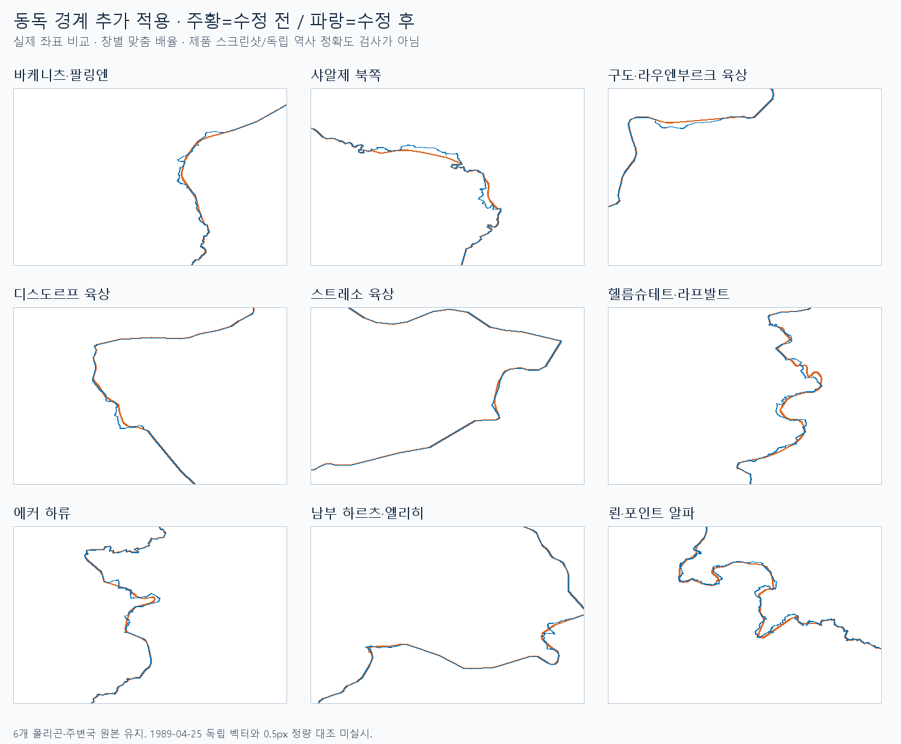
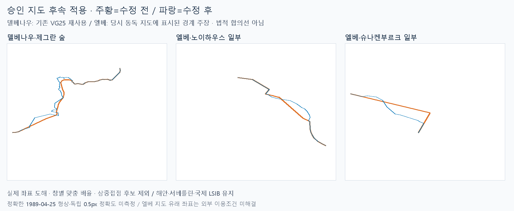

# 동독 남은 경계 전체 후속 — 벡터 및 승인 지도 일부 적용

> ID: `GEO-DDR-ALL-FOLLOWUP-20261023` · 상태: `local-applied / provisional / map-review-approved` · `work/gis only`  
> 기반: 앱8526d2b5 / 자료bfc9adcc · 기준일1989-04-25 · main 병합·푸시·배포 없음

남은 목록 전체를 검토 대상으로 이어받아 **아래9개 범위에서 VG25를 추가 적용**했다. 나머지에 일괄 현대선을 덮어쓰지 않았다. 이 보고서 제목의 ‘전체’는 작업 대상이며 **전 구간 교체 완료를 뜻하지 않는다**. 이후 사용자가 네 정치본을 확인하고 복원을 승인했다. **델베나우 VG25 추가 범위와 엘베 지도 기반 두 부분을 후속 적용**했다. 삼중접점 후보는 국제 LSIB와 충돌하여 제외했다. 남은 전체가 완료된 상태는 아니다. **엘베 지도 유래 좌표는 공급자의 외부 이용조건이 미해결이므로 로컬 연구용 잠정본이며, 공개 배포 전에 조건 해결이 필요하다.**

## 적용 범위

| 구간 | 허용 창 (경도 / 위도) | 교체 연산 |
|---|---|---|
| 바케니츠·팔링엔 나머지 | 10.62–10.83 / 53.795–53.88 | 11 |
| 샤알제 북쪽 나머지 | 10.82–11.01 / 53.645–53.72 | 6 |
| 구도·라우엔부르크 육상 | 10.82–10.99 / 53.49–53.575 | 5 |
| 디스도르프 육상 | 10.65–11.03 / 52.71–52.815 | 6 |
| 스트레소 남쪽 육상 | 11.27–11.60 / 52.94–53.005 | 2 |
| 헬름슈테트·라프발트 | 10.75–11.17 / 52.09–52.335 | 28 |
| 에커 하류·하르츠 산록 | 10.50–10.78 / 51.895–51.985 | 12 |
| 남부 하르츠·엘리히 육상 | 10.30–10.68 / 51.575–51.695 | 8 |
| 뢴·포인트 알파 육상 | 9.78–10.25 / 50.39–50.74 | 59 |

합계137은 생성기가 기록한 **교차점 사이 교체 연산 수**다. 이미 채택된 창과 겹치는 부분·재분절을 포함하므로 독립된 새 역사 국경137개나 전체 해당 지역 교체율로 해석하지 않는다. 실제 변형은 별도 전후 형상에서 확인했다. 범위에 들어도 안전한 실제 교차점이 없는 나머지 선은 유지한다.

생산 좌표는 고정 BKG VG25(EPSG:25832, CC BY4.0, SHA256 `F19CC29909E93A40CF047576D5E5215B9319969FBF373A5E23B52DE5C3F0D573`)의 기존 0.0002° 표시 파생본이다. 기존 C++ 레시피의 교차점 접합을 사용했다. 첫9개 창에는 지도 픽셀에서 생산 좌표를 추적하지 않았다. 아래 승인 지도 후속에서만 엘베 두 부분을 별도로 추적했다. 국제국경에는 VG25를 추가하지 않았다.

## 독립 문헌과 해석

[LGLN NaVKV1/2016](https://www.lgln.niedersachsen.de/download/113504/NaVKV_2016_1.pdf) 인쇄pp72–73/PDF pp73–74의 Dieter Kertscher 서평을 원문으로 읽었다. 전직 국경 지적측량 사무소장이 공동 설치 표석과 측량 기록이 현재 신·구 연방주 경계의 기준임을 설명하며 Amt Neuhaus 귀속 변경을 예외로 든다. 이는 **고정 측량 경계의 연속성** 근거다. 현대 하도 전체가1989와 같다는 보증으로 확대하지 않았다.

같은 자료는 **엘베와 바르메보데가1978년 공동 획정 작업에서 제외**되었음을 설명한다. 바르메보데는 이번에 명시적으로 보류 목록과 회귀에 추가했다. 울타리·순찰로와 정치 경계도 구별한다.

구간별 보강: [GRENZHUS 바케니츠](https://www.grenzhus.de/wakenitz-und-trave/), 라우엔부르크 군의 옛 내독경계/현재 주경계 연속성 및1990Schaalsee 조례, [스트레소 공식 기념지 설명](https://www.seehausen-altmark.de/familie-freizeit/kultur-tourismus/aktivitaeten-ausflugsziele/denkmaeler-gedenkstaetten/gedenkstaette-stresow/), LGLN2010 국경 측량 기록, Nationalpark Harz 에커 설명, Hessen 주기록보관소1834 경계 승계 설명, 바이에른 측량청1973 표석 설명을 함께 사용했다. 기존 원문은 앞선 적용·조사 증거에서 재사용하고 신규 취득본은 [captured-sources.json](east-germany-remaining-all-2026-10-23/captured-sources.json)에 URL·SHA·실패를 기록했다. 토지 정체성 판단은 문헌과 현행 벡터의 해당 범위를 결합한 잠정 판단이다.

앞서 승인한 북부30km 지도는 같은 좌표계·범위를 유지해 재사용했다. 호안·정치 경계·도로를 육안 대조했고, 원본 지도는 복제하지 않았다. 정확한1989-04-25 갱신일과 독립 정합 잔차는 미측정이다. 독립 당시 벡터에 대한0.5 CSS px 통과는 주장하지 않는다.

## 실제 변화와 최소 확인

- 정점7,942→8,652, 폴리곤6개·구멍 유지, 유효. 전후 대칭차36.25550km²는 수정량이며 역사적 위치 오차/영토 변경량이 아니다. 겹치는 창의 면적은 합산하지 않는다.
- 허용 창 밖 경계 차이는 부동소수점 수준(1.78e-15°). DEU/POL/CZE 원본 해시와 객체ID·존속기간·메타데이터 동일.
- 새 회귀는 생성 전9개 창 모두 변경량0으로 실패했고 생성 후 집중 Python 형상 회귀11개 통과. 엘베/노이하우스·알란트/엘베·두메·오레/드뢰믈링·바르메보데·벤데바흐·베라·트라베/해안 보존과 메호어호 수면 귀속 유지 포함.
- 개별 gzip·국가 묶음·준비 메시·웹/앱 판본 메타데이터 생성 완료. 준비 메시326개 중324개 재사용. 실제 가져오기/공유 경계 메시 회귀1개 통과. 첫 벡터 단계 웹·앱 단일 사례1개는4.0분에 통과했다. 앱 가져오기·Undo/Redo·GPKG 저장·웹 재열기 형상 동등, 앱/페이지 오류 없음. 승인 지도 후속은 새 증거 폴더에서 별도1회 확인한다.
- 전체 검사·벤치마크·WASM/Windows 실행파일 재빌드는 하지 않는다.

기존 내장 세계의 체코슬로바키아 `unknown-peer-overlap` 제외78.55315km²는 전후 동일하다. 라이브러리 원본과 내장 세계 전체가 같다고 주장하지 않는다. [runtime-proof.json](east-germany-remaining-all-2026-10-23/runtime-proof.json)에서 개별 gzip은 원본과 같고, 전송 묶음의 국가 바이트는 개별 배포 gzip과 같으며 준비 메시 둘이 존재함을 확인했다. [compiled-scope-proof.json](east-germany-remaining-all-2026-10-23/compiled-scope-proof.json): 새 창 안의 배포 경계는 원본과 같고 창 밖 배포 경계는 이전과 부동소수점 수준으로 같다.

첫9개 벡터 단계 읽기 전용 검토에서 중대한 지적 없음. 지도 후속 검토에서는 노이하우스 비폐합 역행1곳을 지적받아 원도 재판독 후 수정했다. 검토자는 테스트·생성을 추가 실행하지 않았다. [추가 압축 원문 목록](east-germany-remaining-all-2026-10-23/captured-extra-sources.json)에 헬름슈테트 박물관2015 설명, 공식 라프발트2019 규정, GeoSN 국제국경/측량 설명, Thüringen 열린 역사 지도 범위도 기록했다. 현행 GeoSN 설명은 체코 국경의 장기 연속성과 나이세 수중 정치 경계가 양안 표주 위치와 다름을 설명하므로 표주를 단순 연결하지 않았다.

## 승인 지도 후속 복원

사용자 답변 **“정합 확인, 복원 진행”**으로 위 네 실제 정치본의 검토 절차를 완료했다. 공급자 지오리퍼런싱 EPSG:25832, 30km/2400px=12.5m/원본픽셀을 그대로 유지했다. 각 도엽의 내용연도와 발행연도는 구별하며, 정확한1989-04-25 유효일은 독립 확인하지 못했다.

| 적용 부분 | 방식 / 실제 범위 | 교체 연산 |
|---|---|---|
| 델베나우·제그란 숲 | 내용1989/발행1991 TK25AS의 정치 경계 기호와 고정 경계 연속성 대조 후 기존 VG25 재사용. 승인 지도의 실제 덮인 창10.75–10.99/53.45–53.59만 허용. | 8 |
| 엘베·노이하우스 일부 | 지도상 검은 정치 경계 띠를 운영자 가이드로 추적한 마스터 약9.84km 중 기존 선과 실제 교차하는 부분만 연결. 창10.72991–10.82470/53.25800–53.30156. | 3 |
| 엘베·슈나켄부르크 일부 | 지도상 정치 경계 띠 추적 마스터 약7.32km 중 안전 교차 부분만 연결. 창11.53445–11.62216/53.03136–53.05600. | 2 |

위13개도 교체 **연산**이며13개의 독립적인 새 국경 또는 지도 마스터 전체 길이의 반영을 뜻하지 않는다. 엘베는 양국 간 획정 합의가 없었던 부분의 **당시 동독 지도에 표시된 주장**으로 기록한다. 강둑·제방·군사 울타리·현대 노이하우스 내부 주경계를 대용하지 않았다. 1981 NVA 교본(내용1980)의 범례를 보조 판독 자료로 확보했으며, 해당 TK25 도엽 자체의 범례라고 주장하지 않는다.

추적은 승인 원도의 운영자 경로 주변에서 정치 경계의 검은 인쇄 기호를 찾고 육안 대조했다. 1.5원본px 선 정리, 중복된 닫힌 추적 고리 제거를 기록하고 원래 추적도 보존했다. 최종 읽기 전용 검토에서 노이하우스의 가이드 법선 탐색이 곡률부에서 넘쳤다가 돌아오는 비폐합 역행 약100m를 발견했다. 원도6배 crop을 재판독해 인쇄선에 없는 돌출점1개만 제거했고, 수정 전 마스터/추적과 원도 crop을 그대로 보존했다. 해당 구간의 진행 방향 회귀가 수정 전 실패한 것도 기록했다. 원도·고리/역행 정리 전 추적·정리 후 마스터는 `private-evidence/ddr-remaining-all-2026-10-23/`에 별도 보관한다. 참조 폴리곤의 인공 폐합선·끝단은 허용 창 밖에 있으며 실제 교차점 사이의 원도 선형만 사용한다. 지도에 없는 부분을 채우거나 접합용 직선을 만들지 않았다.

**이용조건 미해결:** [LAiV 역사 지도 제품](https://www.laiv-mv.de/Geoinformation/Karten/Historische-Karten/)과 [Open Data 안내](https://www.laiv-mv.de/Geoinformation/Open_Data_Angebot/)의 개방 안내 및 해당 WMS의 외부 이용 제한 문구가 일치하지 않는다. 엘베 지도 유래 좌표의 외부 이용조건은 확인 완료로 표시하지 않는다. 이번 적용은 로컬 연구용 잠정본이며, 해당 부분의 외부 푸시·공개 배포 전에 조건을 해결해야 한다. 원도와 지도 위 그림은 공개 보고서 묶음에 넣지 않았다. GeoSN 데이터의 별도 dl-de/by2.0 조건과 NVA 범례 원도의 CC BY-NC4.0도 구별한다. [추가 이용조건·범례 취득 목록](east-germany-remaining-all-2026-10-23/map-phase-licensing-legend-sources.json).

삼중접점 넓은 후보는 채택된 국제 LSIB와 VG25 차이 때문에 부분 역행·톱니를 만들었다. 국제선을 다시 덮어쓰는 후보를 그대로 채택하지 않았다. 국제선과 떨어진 안전 창은 실질 변화가 없어 추가하지 않았다. 후보 시도 범위·판정과 마지막 후보 좌표를 보존했으며, 국제 LSIB와의 공통 접점 문제는 남는다. Amt Neuhaus/Bleckede 상세 WFS 요청은 공급자HTTP400 RequestRejected로 실패했고, 이를 상세 벡터 확보로 기록하지 않았다.

후속 전후8,652→8,708정점,6개 폴리곤·구멍 유지·유효. 대칭차5.78478km², 후속 허용 창 밖 경계차0. 전체 단계 전후7,942→8,708, 대칭차42.04028km², 전체 창 밖1.78e-15°. 모두 **수정량**이며 역사적 위치 오차가 아니다. 국가ID·존속기간·메타데이터·DEU/POL/CZE 원본 해시 유지. 기존 국제 LSIB 공유선도 유지했다. [후속 형상 근거](east-germany-remaining-all-2026-10-23/map-phase-geometry-proof.json), [전체 형상 근거](east-germany-remaining-all-2026-10-23/final-geometry-proof.json).

새 후속 회귀는 생성 전3부분 변경량0으로 실패했고, 최종 수정 후 집중 Python13개(비폐합 역행 회귀 포함)와 가져오기/메시1개가 통과했다. 날짜·귀속·구멍·범위 밖 보존·국제 공유선 및 잠정 출처 해석을 포함한다. 원본 개별 gzip·전송 묶음 조각 일치와 준비 메시 존재, 허용 창 안 배포/원본 일치 및 기존CSK 제외78.55315km² 불변을 확인했다. [최종 런타임 근거](east-germany-remaining-all-2026-10-23/final-runtime-proof.json), [최종 배포 형상 범위](east-germany-remaining-all-2026-10-23/final-compiled-scope-proof.json). 첫 지도 단계 브라우저 실행은 VG25 전용 기대 목록에 TK25AS 항목을 잘못 넣은 테스트 오류로 실패했다. 실제 자료에는 항목이 있었으며 기대 목록을 각각 분리했다. 다음 실행은 원도 재판독에 따른 실제 좌표 수정으로 중지했으며, 최종 좌표의 다음 실행은 앱 가져오기 화면 후 작업자 프로세스가Windows코드3221226505로 종료되어 저장/웹 재열기 완료를 확인하지 못했다. Application1000 기록에서 원인을 확보하지 못했고, 종료 뒤 가용RAM 약6.5GiB였다(실행 중 메모리 부족의 증거는 아님). 최종 입력 영수증을 별도 압축 보존하도록 하고 Node heap 한도를6144MiB로 늘려 같은 단일 사례를1회만 재시도한다. 메모리가 원인이라고 확정하지 않는다. 이 단일 재시도는 **1개 통과(전체5.1분/사례4.9분)**했다. 앱 가져오기·Undo/Redo·파일 저장·웹 재열기 형상 동등, 앱/page 오류 없음. 최종 [웹·앱 근거](east-germany-remaining-all-2026-10-23/final-workflow-retry/web-app-proof.json), [실행 로그](east-germany-remaining-all-2026-10-23/final-workflow-retry/runner.txt), 압축 입력 영수증·GPKG 및 화면 보존. 전체 세계 저장을 포함하는 이 경로는 가벼운 형상 확인이 아니므로 향후 동일 자료의 반복 재실행 근거로 삼지 않는다.

## 남은 목록 전체와 다음 경로

| 남은 부분 | 실제 진행 상태 / 유지 이유 |
|---|---|
| 북부 SH/MV·샤알제 남쪽·델베나우의 미교체 호안/강변·접합 틈 | LAiV 지오리퍼런싱 TK25AS 확보. 내용1989/발행1991 조회4도엽. 정치 확인 승인 후 델베나우 창10.75–10.99/53.45–53.59의 실제 연결 가능한8개 연산 추가 적용. 흰 공백 및 나머지 호안·강변은 제외. |
| 엘베·노이하우스 및1993 이관지 | 내용1988–89/발행1991–93 지도 확보. 현대 VG25의 노이하우스 안쪽 주경계를1989 국경으로 쓰지 않음. 승인 지도상의 엘베·노이하우스 일부만 동독 측 지도 표시 주장으로 잠정 추적·연결. 법적 합의선으로 확정하지 않으며 나머지 하구·이관 구간은 유지. |
| 알란트·슈나켄부르크 | 북쪽 당시 지도 확보(내용1984·89); 남부는 서비스 공백/메타데이터 없음. 승인 지도에 있는 슈나켄부르크 일부만 추적·연결. 지도 공백 및 알란트로 임의 연장하지 않음. |
| 알트마르크 두메·하르퍼뮐렌바흐·오레/드뢰믈링 | 상세 당시 벡터 미확보. 현재 하도와 당시 정치 경계 관계 미확인. Sachsen-Anhalt 공식 AS 목록은1982–88이지만 실제 상세 스캔 미확보. 보호구역 도면을 국경으로 대용하지 않음. |
| 하르츠 나머지·브렘케·바르메보데 | 에커·남부 육상 밖은 보류. 바르메보데1978 미획정 근거 확인. 현 주경계를 확정된1989 선으로 자동 채택하지 않음. |
| 남동 아이히스펠트·벤데바흐·베라·헤센 중부 | 남동 육상 후보창10.08–10.23/51.27–51.405는 실제 교차점이 없어 생성기가 거부. 벤데바흐는 이동성 경계·후속 측량 반영이 이미 확인됨. 당시 상세 지도/측량 도면 필요. Thüringen 열린 역사 지도 다운로드는1852–1880이며1989 원도로 쓰지 않음. |
| 뢴·바이에른 서쪽 잔여·삼중접점 | 뢴 육상은 위 범위만 적용. 삼중접점 GeoSN TK25AS 원도 확보; 조회 도엽 내용1980·88, 일부 공백. 정치본 확인 후 넓은 VG25 후보를 생성했으나 국제 LSIB와 충돌하며 부분 역행·톱니가 생겨 미채택. 안전 범위로 좁힌 후보는 실질 새 형상 변화가 없어 미채택. 임의 접합하지 않음. |
| 폴란드·체코 국제국경의 미채택 조각 | 현대 독일에 이미 채택된 LSIB만 계속 유지. 이번에 상세한 독립1989 국제국경 벡터를 추가 확보하지 못함. 하구·나머지 나이세·삼중접점은 자동 확장하지 않음. |
| 해안선·서베를린 | 원래 요청 범위 밖이며 유지. |

신규 정치본4장은 `.working/bfc9adcc…/private-evidence/ddr-remaining-all-2026-10-23/remaining-alignment-atlas.png`에 있다. 공급자 EPSG:25832 지오리퍼런싱을 그대로 사용했으며 현재 경계에 맞춰 지도를 변형하지 않았다. [map-capture-manifest.json](east-germany-remaining-all-2026-10-23/map-capture-manifest.json)에 요청 URL·바운드·원본SHA·도엽 응답 보존. 독립 검사점 잔차/정확한 갱신일 미확인, 흰 공백은 추적 제외. 원지도/지도 위 그림은 내부 연구 증거로 공개 보고서 묶음 밖에 보존한다.

이 문서는 [직전 북부 적용](east-germany-ratzeburg-mechow-applied-2026-10-23.md)의 실적을 유지하며, 위9개 창·승인 지도 후속3부분 및 보류 목록을 후속 갱신한다. 전체 남은 경계 복원이 완료되었다고 표시하지 않는다.

최종 로컬 상태: 자료/근거를 외부 자료 저장소에 압축 보관하고 work/gis의 자료 핀과 레시피·회귀·웹/앱 메타데이터를 함께 로컬 커밋한다. main 병합·원격 푸시·공개 배포는 하지 않는다. LAiV 지도 유래 엘베 좌표의 외부 이용조건은 미해결 상태를 유지한다.
