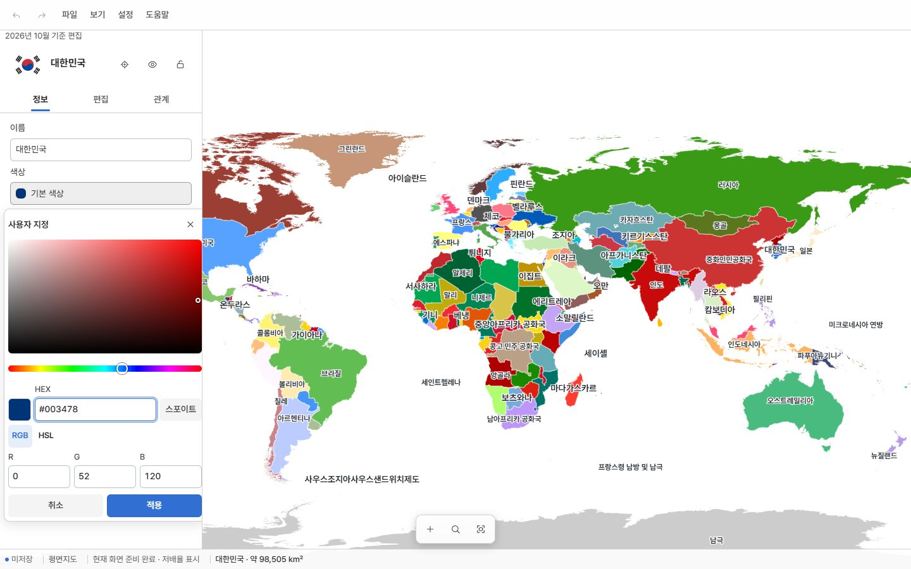

# Web·App 공통 스타일·규칙 전수 조사

> 보고서 ID: PL-UI-AUDIT-20261026 · 상태: 조사 완료, 수정 미적용 · 지도 반영: not-applied  
> 조사일: 2026-10-26 · Web/App 소스: `095d312fd32479dfd393f352eb4d74a475f2a916`  
> 자료 핀: `68380579a7c7a1bd8ec97683b7517502c1389c3c` · 작업: `D:/dev/worktrees/ui`, `work/ui`

## 결론

일반 버튼의 공통 클래스는 대체로 연결돼 있다. 남은 문제는 클래스 누락보다 **특수 창의 강한 선택자, 공통 규격 문서와 토큰 불일치, 제품 CSS의 공통 외형 재선언, 검사에서 제외되는 규칙**에 집중돼 있다. 이번 조사는 제품 소스를 수정하지 않았다.

## 범위와 방법

- canonical frontend catalog와 Web/App 원본 템플릿에서 431개 소스(CSS 28, HTML 17, JS 386)를 조사했다. 생성 번들을 중복 집계하지 않았다.
- 정적/템플릿 요소·컴포넌트 정의 335곳, 동적 생성 지점 37곳, CSS 선언 6,434개, 인라인 후보 20곳을 수집했다. 컴포넌트 컨테이너와 일반 팩토리도 포함하므로 이를 실제 버튼 372개로 해석하면 안 된다.
- 정적 태그/JS 문자열 및 AST로 생성 지점을 추출했다. 실행 때 조립되는 모든 문자열을 완전히 평가한 목록은 아니다. 전체 파일 목록·해시는 source-census.json에 있다.
- 공통 기준: `docs/architecture/ui-architecture.md`, `ui-components.md`, source catalog, 디자인/애플리케이션/컴포넌트 토큰과 실제 CSS cascade.
- 고정된 개발 서버의 Web 뷰어와 App 편집기 프런트엔드를 IAB에서 각각 확인했다. 1440×900, 1280×720, 390×844, 844×390, 320×640 CSS px에서 메뉴·날짜·검색·선택 객체·색상·환경설정을 확인했다. 관측별 실제 viewport와 layout은 runtime.json에 있다.
- 844×390은 데스크톱 포인터 환경에서 `compact`로 판정됐다. 실제 터치 기기의 `phone-landscape` 상태를 검증했다고 보지 않는다.
- 역할별 기준으로 측정했다. 아이콘 전용만 버튼 중심과 SVG 중심을 비교했고, 메뉴의 왼쪽 아이콘·글자+아이콘 묶음·탭 내비게이션을 잘못된 편심으로 세지 않았다. 체크박스는 시각적 작은 상자 대신 label 영역도 기록했다.

## 확인된 문제

| 우선 | 요소/문제 | 근거 | 권장 수정 |
| --- | --- | --- | --- |
| 1 | 모바일 사용자 지정 색상창 닫기 아이콘이 **40×48px** | runtime.json의 editor-mobile-custom-color. controls.css:1034의 `.ui-custom-color :is(.ui-button, ...)`가 일반 버튼 48px를 아이콘에도 강제한다. controls.css:1175의 정사각형 아이콘 규칙보다 specificity가 높다. SVG 중심은 정상이다. | 공통 아이콘 예외를 둔 일반 조작 영역 판정으로 정리. 창 전용 강제 크기 규칙을 중복 유지하지 않는다. |
| 1 | RGB·HSL 버튼만 **13px**, 일반 버튼은 14px. 같은 창의 HEX/R/G/B 필드 label도 작은 글자 규칙 사용 | controls.css:965–1000. RGB/HSL은 PC·모바일 계산 스타일에서 13px 확인. 필드 label의 별도 13px는 소스 확인이며 label 자체의 런타임 값은 별도 수집하지 않았다. | 도움말과 실제 버튼·필드 label을 구분해 공통 본문 규격 적용. |
| 1 | 모바일 아이콘 규격의 원본이 충돌 | ui-architecture.md:29는 48px, design-tokens.css:98 및 실제 아이콘은 40px. 이전 사용자가 선택한 값은 40px이다. | 40px 선택을 기준으로 문서·토큰·검사를 함께 정렬. 모든 40px 버튼을 잘못된 개별 예외로 간주하지 않는다. |
| 2 | Web 날짜창이 공통 필드/버튼 외형을 다시 선언 | apps/viewer/css/viewer.css:10–22. padding/font/color/background/border/radius 재선언 12개 후보. 날짜 span line-height도 별도 1.15. | 제품 파일에는 위치·배치만 남기고 필요한 날짜 변형은 기존 공통 소유자에서 관리. native 월 select는 사용자 요구이므로 유지. |
| 2 | 레이아웃 파일이 컴포넌트 padding까지 소유 | layout/surfaces.css:117,225,264,283,306,313,322 등 7개 선언 | safe-area·배치는 레이아웃에서 유지하되 header/nav/body 여백 외형은 담당 컴포넌트 variant로 귀속. 현재 화면이 깨졌다는 뜻은 아니다. |
| 2 | 휴대폰 가로 내비게이션 글자 **10px** | component-tokens.css:7 → mobile-sheets.css:364–365. 일반 내비게이션 글자 규격보다 작다. | 별도 축소를 제거하거나 문서화된 정당한 예외로 검토. 실제 coarse-pointer 가로 화면은 미검증이다. |
| 3 | Web 엔트리에 토큰화되지 않은 px 배치와 ID 선택자 | viewer.css 전체. px 기하 선언 22개, ID 선택자가 포함된 선언 16개. 중복 집계 가능 | 간격 토큰·제품 root 아래의 클래스 기반 소유로 정리. 1px 접근성 숨김과 지도 캔버스 호스트는 목적을 보존해야 한다. |
| 3 | 개발 진단용 버튼은 공통 클래스 없이 생성 | apps/editor/diagnostics.js:349 | 제품 UI와 별도인 개발 진단 경로. 정상 제품 버튼 결함 수에 합치지 않고 진단 UI 정비 대상으로 관리. |

### 색상창 증거

모바일 닫기 버튼의 40×48px는 스크롤된 상태에서도 DOM 계산값으로 확인했으며, 화면에 보이는 도구 패널 여백을 버튼 크기로 오인하지 않았다. 모바일 색상창의 위쪽 내용이 캡처에 보이지 않는 현상은 내부 스크롤 여부를 끝까지 재현하지 않아 별도의 잘림 결함으로 확정하지 않았다.

## 정상 규칙과 전용 규격

- 측정한 아이콘 전용 SVG 중심 오차는 가로·세로 모두 1px 이내였다. 이는 관측한 상태의 결과이며 모든 동적 창의 전체 상태를 보장하지 않는다.
- PC 아이콘은 36×36px, 모바일은 40×40px가 기본이었다. 앞서 지적한 색상창 닫기만 40×48px였다. 지도 도구 주변 흰 영역은 패널 여백으로 버튼 자체가 아니다.
- 일반 메뉴 행과 설정창 버튼은 PC 36px/모바일 48px 규칙을 따랐다. 모바일 하단 내비게이션은 아이콘+글자 묶음으로 56px 높이였으며 아이콘 단독 버튼으로 분류하지 않았다.
- 색상 견본·테마 칩은 전용 크기 토큰을 사용한다. PC 24px/모바일 28px 견본을 일괄 36/40/48px로 바꾸는 것은 이번 규칙의 의도가 아니다.
- HSV 면은 별도 좌표 조작 컴포넌트다. 일반 버튼 클래스가 없는 것을 위반으로 세지 않았다.
- 지도 라벨 타이포그래피 9개 후보는 지도 표현의 별도 규격이다. `[hidden]`/`.hidden`의 `!important` 2개는 기초 숨김 규칙이다.
- 인라인 후보 20개는 진행률·자료 색·측정된 스크롤/팝오버 크기·지도 표시로 분류했다. 모델 color 속성이 DOM style처럼 추출된 2곳은 오탐이다. 인라인이 있다는 이유만으로 규칙 위반으로 확정하지 않았다.
- 기본 설정 스위치의 작은 시각적 막대를 클릭 영역 전체와 혼동하지 않았다. native 월 선택 UI 역시 명시적으로 유지한 사용자 요구다.

## 검사 결과와 사각지대

관련 소스 검사 5개(ui-architecture, ui-components, ui-layering, ui-spacing, ui-information-architecture)는 모두 exit 0. 전체 테스트, C++ 빌드, GIS 검사/재생성은 실행하지 않았다.

그러나 현 검사는 실제 계산 크기와 specificity를 모두 검사하지 않는다. ui-components는 공통 클래스 연결이 중심이고, architecture는 viewer.css 8192B 제품 예산과 legacy ratchet을 허용한다. layout 시각 속성 검사에는 padding이 빠져 있다. 따라서 **검사 통과를 공통 규칙 전체 준수로 해석하면 안 된다**.

자동 후보 65개는 확정 결함 65개가 아니다. 같은 선언에 여러 flag가 붙을 수 있고 지도·기초 규칙의 정당한 예외도 포함된다. `reviewed-style-candidates.json`에 후보별 판정을 저장했다. 동일 selector/context/property 내 서로 다른 값 중복은 0개였지만 다른 selector 간 cascade 충돌은 색상창에서 실제 발생했다.

## 전수 목록과 증거

- [전체 파일·원문 위치·CSS 선언·해시](source-census.json)
- [정적/템플릿 요소 목록](controls.csv), [동적 생성 지점](dynamic-factories.csv), [원본별 검토 색인](reviewed-element-index.csv)
- [CSS 후보 목록](style-candidates.csv), [후보별 분류](reviewed-style-candidates.json), [인라인 분류](reviewed-inline.json)
- [실측 원자료](runtime.json), [실측 요약](runtime-summary.json), [아이콘별 계산값](icon-measurements.csv)
- [관련 검사 결과](checks.json), [개발 서버 snapshot](runtime-snapshot.json), [동시 소스 변경 확인](source-drift.json)
- 캡처 01–17: Web/App 기본 화면, 설정, 파일/보기 메뉴, 날짜 월 선택, 검색, 객체 속성, 색상, 모바일/가로/320px.
- source census helper와 finalize helper를 함께 보관한다. helper의 상대 import는 앱 worktree의 build-native에서 실행하는 구조이며 report 폴더에서 바로 실행하는 CLI가 아니다.

## 검증 한계와 보존

소스 전수 조사와 대표 상태의 실제 화면 측정을 완료했다. **실제 네이티브 WebView, 실물 터치, 모든 조건부 대화상자/편집 단계, 다크 테마 적용, 200% 글자 확대, 모든 키보드·스크린리더 상태**는 검증하지 않았다. 사용자 작업을 바꾸는 생성·적용·파일 열기/저장·프로젝트 변경을 조사만을 위해 실행하지 않았다. 전체 접근성 적합이나 전체 사용자 검증 완료를 주장하지 않는다.

조사 중 다른 채팅이 renderer 2개와 관련 테스트 2개를 수정하고 `3d5744b81758c4a0d4502e205b30c44cdc6109af`로 커밋했다. 감사 대상 CSS/HTML/UI 생성 코드에는 변화가 없었다. 이 작업을 수정·스테이징하지 않았으며 고정 snapshot으로 화면 재조사를 마쳤다. 상세 소스 drift와 현재 HEAD는 별도 JSON에 남겼다.

제품 변경·main 병합·앱/웹 배포는 수행하지 않았다. 수정 순서는 **공통 기준 정렬 → 색상창 cascade/글자 → 날짜창 소유권 → 레이아웃·검사 사각지대**가 적절하다. 기존 40px 모바일 선택과 native 월 UI는 보존해야 한다.
