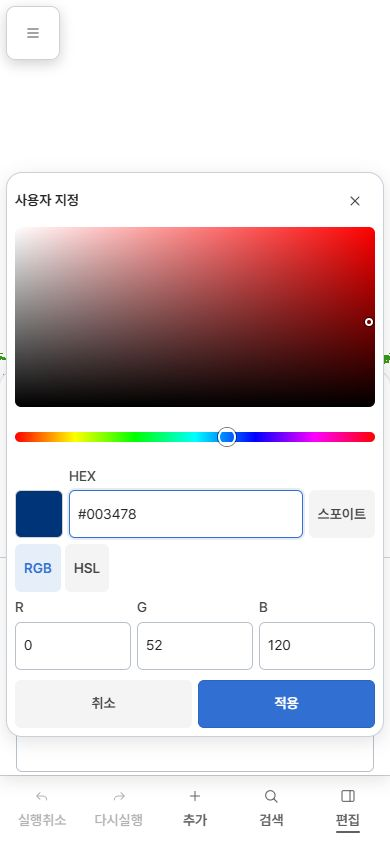
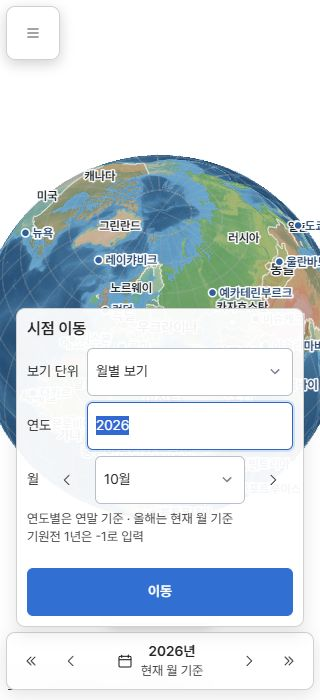

# 공통 스타일·버튼 규칙 통일 구현 결과

> 보고서 ID: PL-UI-COMMON-20261026 · 구현 완료 / 실제 네이티브 WebView 미검증  
> 시작: 2026-10-26 · 최종 확인: 2026-10-27  
> 앱 코드 커밋: `eedeae46e2c6ffdf325f822922611cf6d2ce5821` · 상설 `work/ui`  
> 기준 조사: [공통 규칙 전수 조사](../common-rule-audit-20261026/README.md)

## 구현

- 공통 아이콘 규격을 PC 36×36px, 모바일 40×40px로 문서·토큰·검사에서 일치시켰다.
- 일반 조작 영역은 기존 `--ui-control-height`를 통해 PC 36px/모바일·휴대폰 가로 48px를 공유한다. 화면별 높이 강제 규칙을 제거했고 아이콘·견본·HSV 면의 별도 크기는 보존했다.
- RGB/HSL 버튼에 공통 일반 버튼 클래스를 연결하고, HEX/채널 label을 14px로 맞췄다. 도움말은 13px다.
- 가로 내비게이션은 기존 폭을 유지하고 14px 글자·줄바꿈·내용에 따른 높이·세로 스크롤을 사용한다. 일반 내비게이션 외형을 담당 컴포넌트로 옮기고 utility의 중복 규칙을 제거했다.
- 날짜창의 필드·버튼 skin을 제품 CSS에서 제거했다. 일반 필드 skin을 기존 공통 primitive로 옮겨 날짜창과 색상창이 공유한다. native 월 드롭다운·연도별 기능·기존 위치를 유지하고 구분선을 추가하지 않았다.
- 제품 CSS는 클래스 기반 위치·배치와 의미 토큰을 사용한다. 날짜 설명·오류·불러오기 표현은 기존 담당 공통 컴포넌트에 귀속했다.
- 레이아웃의 외형 padding을 기존 Surface/Mobile component로 옮겼다. 개발 진단 버튼은 공통 버튼을 사용하며 독립 버튼 skin을 제거했다.
- 고정 위치 색상창이 멈춘 편집 패널의 `translateY(0)`에 가려지는 문제를 실제 모바일 흐름에서 재현했다. 열린 패널은 `transform:none`을 사용하고, 중복된 editor open 변형은 제거했다. 드래그·정착 애니메이션과 닫힘 변형은 유지했다.
- 공개 API·프로젝트 모델·저장 형식·명령 로직은 변경하지 않았다. 생성물을 직접 수정하지 않고 기존 frontend builder/development server로 Web/App HTML·CSS를 검증했다.

## 기존 조사 항목 판정

| 항목 | 결과 |
|---|---|
| 모바일 색상창 닫기 40×48px | 수정 완료: 40×40px, SVG 중심 오차 0px |
| RGB/HSL·필드 이름 13px | 수정 완료: 14px·줄높이 1.4 |
| 문서 48px / 실제 모바일 아이콘 40px | 수정 완료: 기존 사용자 선택인 40px로 일치 |
| 날짜창 제품별 외형 재선언 | 수정 완료: 기존 공통 소유자 사용 |
| 레이아웃 padding·Web 직접 px/ID 선택자 | 수정 완료: 컴포넌트 소유권·의미 토큰·클래스로 정리 |
| 휴대폰 가로 이름 10px | 수정 완료: 14px, 폭 유지·줄바꿈 |
| 개발 진단 버튼 클래스 누락 | 소스 수정 완료: 공통 버튼 연결. 진단 전용 실제 네이티브 화면은 미검증 |
| 검사의 제품 CSS 누락·padding 사각지대 | 수정 완료: canonical frontend index로 제품 CSS 포함, 소유권 위반 거부 |
| 견본·HSV 면·지도 라벨·숨김 상태 | 정당한 전용 규격 유지, 조건과 검증 항목 문서화 |

## 검증

### 자동 검사

- `button-consistency.spec.mjs`: 11개 통과. 1440/844/390/320px, 실제 동적 색상 control, 일반 버튼/field 최소 높이, native proxy의 1×1 숨김 영역, SVG 중심, disabled/pressed/focus, 터치 가로 내비게이션과 200% 글자 확대를 검사했다.
- 마지막 두 색상창 회귀 사례는 추가로 실행해 펼친/접힌 drawer 모두 닫기 hit-test, 드래그 변형, 닫힘 상태를 확인했다. 이 2개는 위 11개의 부분집합이며 별개의 13개로 세지 않는다.
- 단위 7개 통과: architecture 회귀 5개와 기존 custom-color 값 변환 2개.
- 관련 UI 소스 검사 5개(architecture/components/layering/spacing/IA) 통과. 변경 JS/검사 파일 ESLint 통과.
- architecture checker는 스타일 검사에 필요하지 않은 전체 frontend/GIS snapshot 생성을 제거하고 canonical 소스 index와 HTML 조립을 읽는다. 작은 현재 구조 fixture로 제품 skin과 layout padding 위반을 거부하는 것을 검증했다.
- 실패를 먼저 재현한 로그: browser-red, architecture-red, landscape-fields-red, native-proxy-red, sheet-clip-red. 마지막 성공 로그는 browser-buttons, sheet-clip-green, unit-green, check-*, eslint.
- 검사 서버를 뷰어 전용으로 바꾼 뒤 색상 control import가 실패한 실행은 환경 오류였다. 뷰어가 App 전용 모듈을 제외하는 정상 계약이며, 올바른 editor 서버에서 다시 실행해 통과했다.

전체 테스트·C++ 빌드·GIS 검사/재생성·native build·패키징은 실행하지 않았다.

### 실제 화면

- IAB에서 실제 Web 뷰어 날짜창을 열어 월별 보기와 native 월 dropdown을 확인했다. PC 1440×900과 모바일 320×700에서 확인했으며 모바일 일반 필드는 48px/14px/6px radius였다.
- 실제 App 프런트엔드에서 검색 → 대한민국 선택 → 색상 → 사용자 지정 흐름을 실행했다. PC 1280×720과 모바일 390×844를 확인했다.
- 최종 모바일 화면에서 색상창 전체와 닫기·취소·적용이 보였다. 닫기 40×40px와 실제 hit-test 접근 가능, sheet transform:none을 확인했다. 취소 후 객체 이름 `대한민국`, 색상 `#003478`이 유지되고 popup이 닫혔다.
- PC 색상창 캡처는 최종 모바일 clipping 수정 전 상태다. PC에는 해당 모바일 변형이 적용되지 않는다. 720px 높이에서 하단 일부는 기존 panel scroll 범위에 있으며, 모든 PC popup 배치 조합의 검증 완료를 주장하지 않는다.
- 실물 터치와 실제 네이티브 WebView는 미검증이다. 현재 native 입력 해시 `2596d458378169db5e51d5756fc3d7d6ce0c7fe4e722186f598c6b4cdbeafd50`에 맞는 development executable이 준비된 cache에 없었다. 기존 cache의 해시는 `4d5178f982608a577cb1316528626991114908f23ee29d55d3e32fdbb5da813c`로 달라 실행 근거로 사용하지 않았다. 새 CI 빌드나 패키징으로 범위를 확대하지 않았다.
- 사용성 사용자 검증과 전체 접근성 적합 판정은 수행하지 않았다.

실측 원자료는 [runtime-controls.json](runtime-controls.json), 빌드/자료 정체성은 runtime-snapshot.json 및 editor-final-snapshot.json, native 제한은 native-status.json에 있다.

## 변경 보존과 범위

앱 코드 커밋에는 이번 소스·검사·문서 20개만 포함했다. 다른 채팅의 renderer/terrain/Pages/GIS 관련 미완료 변경과 runtime 자료 핀은 커밋하지 않았다. 검증 실행 시 다른 채팅의 작업 자료 핀은 `473b2babd37f0331af5e096ee4152a15af6a8d0f`였으며 최종 editor snapshot에 기록했다. 이번 앱 커밋의 자료 핀 `68380579a7c7a1bd8ec97683b7517502c1389c3c`는 변경하지 않았다. 자료 핀 변경을 검증 완료한 것으로 주장하지 않는다.

main 병합·앱 원격 push·웹 배포·앱 실행 파일 갱신은 하지 않았다. 기존 개발 서버·빌드 경로를 사용했고 임시 스크립트는 남기지 않았다. 검증 서버와 에이전트 브라우저 탭은 종료했다. 기존 공유 incremental/cache와 다른 채팅의 검사 출력은 현행 소비자가 있어 보존했다. 이 폴더의 로그·화면·snapshot은 이번 검증 근거로 보관한다.
