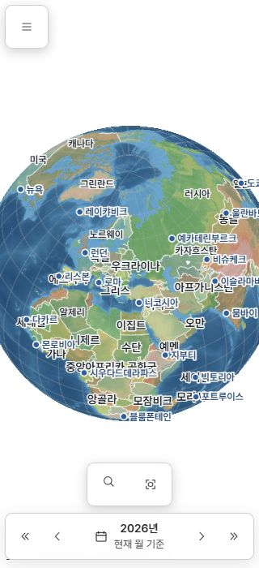

# 모바일 검색 버튼 아이콘 위치 조사

> 상태: 원인 확인 / 제품 수정 미적용 · 조사일: 2026-10-27  
> 로컬 소스: `255b952a2a9c36fd0686bacf9e1c8bf709c19eb8`, `work/ui` · 시작/종료 작업트리 clean  
> 실제 확인: https://kimjeon-il.github.io/Pando/ 의 390×844, 320×700, 1440×900 CSS px 화면

## 확인 결과

웹 모바일 하단 지도 도구의 검색 돋보기에서 재현했다. 320px 화면에서 검색 아이콘 중심 y=593, 옆 전체 지도 보기 중심 y=597로 검색이 4px 위에 있다. 390px에서도 각각737/741로 같은4px 차이다. PC에서는 두 중심이867로 일치한다.

- `.map-command-search` 감싸는 영역은 48×48px.
- 내부 `#objectSearchBtn`은 공통 아이콘 규칙의 40×40px이고 감싸는 영역의 왼쪽 위에서 시작한다.
- 버튼 내부 SVG는 버튼 자체의 정중앙이다. 잘못된 SVG 패스나 버튼 내부 정렬이 아니다.
- 검색 영역의 중심은40px 버튼 중심보다 가로/세로4px 떨어져 있다. 옆 버튼은 toolbar 가운데에 있으므로 높이 차이가 눈에 드러난다.
- PC에서는 감싸는 영역과 버튼 모두36×36px여서 문제가 나타나지 않는다.
- 검색창을 연 뒤 입력 안 돋보기는 48px 필드의 수직 중앙(오차0px)이었다.

## 원인과 빠진 검사

`shared/frontend/css/components/map-search.css:114`의 `.map-command-search` width/height가 일반 입력 영역용 `--ui-control-height`를 사용한다. 이 값은 앞선 공통 규칙 변경에서 모바일48px가 됐다. 내부 아이콘 버튼은 별도 `--ui-icon-control-size`40px를 사용하므로 두 크기가 갈라졌다.

기존 button-consistency 검사는 독립적으로 배치한 버튼/SVG의 크기와 중심을 확인했지만 실제 `.map-command-search`의 바깥 영역 및 이웃 도구와의 중심을 비교하지 않았다. 버튼 내부 검사만 통과한 이유다.

수정 시에는 닫힌 검색 영역을 공통 아이콘 크기 토큰으로 맞추고, 펼친 입력 영역은 기존 일반 입력 높이를 유지하는 것이 적절하다. SVG에 임의 여백/이동을 추가하지 않는다. 기존 검사에 실제 toolbar → search wrapper → icon button 구조를 넣고 옆 버튼과 중심 y 차이1px 이내를 확인해야 한다.

## 증거와 범위

[측정 원자료](measurements.json). 320px 스크린샷은 지도와 UI가 표시된 뒤 저장하고 확인했다. 초기 불러오기 중의 캡처와 잘못 잘린 캡처는 최종 증거로 사용하지 않았다. 잘못 잘린 task-owned 캡처1개는 제거했다.

현재 배포 웹에서만 확인했으며 App 실물 모바일/WebView의 같은 현상을 확인한 것은 아니다. 소스 파일은 수정하지 않았고 테스트·빌드·main 병합·배포를 실행하지 않았다. 조사 탭은 닫고 viewport 설정을 복구했다. 이 보고서·원자료·화면만 선택 범위로 원격 보관한다.
